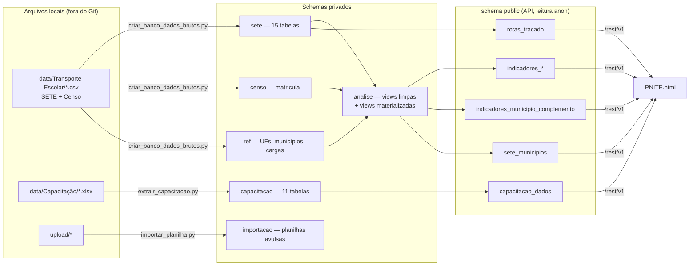
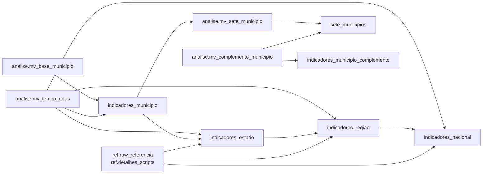

# PNITE — Banco de dados (Supabase)

Estrutura do banco que alimenta a **PNITE**: o que existe em cada schema, como os dados fluem dos arquivos brutos até a interface, quais regras de cálculo ficam no banco e como atualizar.

> Retrato de 23/10/2026 (migração `0014`), carga do SETE `ano_carga = 2026` e Censo Escolar 2025. Banco com cerca de 2,2 GB.
> A fonte da verdade da estrutura são as migrações em [`supabase/migrations/`](supabase/migrations/); este documento as resume.
> **As colunas de cada tabela e view estão na [seção 10 — Dicionário de dados](#10-dicionário-de-dados--uma-seção-por-tabela)**, uma subseção por tabela.

---

## 1. Visão geral

- **Servidor:** Supabase self-hosted em `https://supabase.transportesufg.eng.br` (PostgreSQL 17 + PostGIS).
- **Duas portas de entrada:**
  - **Administração** (migrações e cargas): endpoint HTTPS `/pg/query`, com a **chave secreta** do `.env`, usado pelos scripts de [`scripts/`](scripts/). O Postgres não aceita conexão direta (portas 5432/6543 fechadas).
  - **Interface** (`PNITE.html`): API REST `/rest/v1/`, com a **chave publishable**, que só lê as views do schema `public`.
- **Privacidade:** os dados brutos têm dados pessoais (CPF, placa, coordenadas de alunos) e ficam em schemas privados, sem `GRANT` para `anon`/`authenticated`. A interface só recebe agregados.



---

## 2. Schemas

| Schema | Conteúdo | Acesso pela API |
|---|---|---|
| `sete` | Dados brutos do SETE (Sistema Eletrônico de Transporte Escolar), um registro por linha dos CSVs | não |
| `censo` | Microdados do Censo Escolar (matrículas por escola) | não |
| `ref` | Referências: UFs, municípios IBGE, pareamento de cargas, valores legados | não |
| `capacitacao` | Capacitações do Transporte Escolar (consolidadas, sem dados pessoais) | não |
| `importacao` | Planilhas enviadas pela pasta `upload/` (uma tabela por arquivo) | não |
| `analise` | Views de leitura limpa e views materializadas de cálculo | não |
| `pnite_meta` | Controle: migrações aplicadas, histórico de cargas, área de trânsito | não |
| `public` | **Somente** views materializadas agregadas, lidas pela interface | leitura (`anon`) |

---

## 3. Dados brutos

Todas as tabelas brutas têm `ano_carga` (ano de referência da carga), `codigo_cidade` (código IBGE de 7 dígitos) e `uf`. Os comentários de coluna no banco trazem as descrições do dicionário do SETE. As colunas de cada tabela estão na seção 10.

### 3.1. `sete` — SETE (`ano_carga = 2026`)

| Tabela | Linhas | Conteúdo |
|---|---:|---|
| `alunos` | 3.761.371 | Alunos cadastrados (deficiência, impedâncias no trajeto, turno, nível) |
| `escola_tem_aluno` | 2.797.574 | Vínculo escola × aluno |
| `rota_atende_aluno` | 1.234.532 | Vínculo rota × aluno (alunos transportados) |
| `rota_passa_por_escolas` | 163.650 | Vínculo rota × escola |
| `ordem_servico` | 91.990 | Ordens de serviço de manutenção |
| `rotas` | 82.887 | Rotas (km, tempo, tipo/modal, impedâncias, `tem_shape`) |
| `veiculos` | 67.730 | Frota (ano, origem própria/terceirizada, capacidade, tipo, modelo) |
| `escolas` | 65.860 | Escolas atendidas (dados MEC/INEP, localização) |
| `motoristas` | 63.739 | Condutores (vínculo, CNH, turno) |
| `rota_dirigida_por_motorista` | 44.912 | Vínculo rota × motorista |
| `rota_possui_veiculo` | 37.583 | Vínculo rota × veículo |
| `rota_shape` | 31.626 | Traçado GeoJSON das rotas + `geometria` simplificada (calculada na carga por gatilho) |
| `monitores` | 22.678 | Monitores (vínculo, turno) |
| `fornecedores` | 4.876 | Fornecedores de manutenção, combustível e seguro |
| `normas` | 339 | Normas e atos municipais |

### 3.2. `censo` — Censo Escolar 2025

| Tabela | Linhas | Conteúdo |
|---|---:|---|
| `matricula` | 178.766 | Uma linha por escola, 264 colunas. As usadas nos indicadores são `qt_transp_publico`, `qt_transp_resp_mun` e `qt_transp_resp_est` |

### 3.3. `ref` — referências

| Tabela | Linhas | Conteúdo |
|---|---:|---|
| `uf` | 27 | Sigla (minúscula), nome, código IBGE, região |
| `municipios` | 5.571 | Municípios IBGE com regiões geográficas intermediária e imediata. Só códigos de 7 dígitos |
| `cargas` | 1 | Pareamento entre cargas: SETE 2026 ↔ Censo 2025 |
| `raw_referencia` | 33 | Valores de referência por escopo (legado + planilhas consolidadas), sobrepostos pelos contadores calculados |
| `detalhes_scripts` | 377 | Detalhes por UF/escopo vindos das planilhas consolidadas (exibidos no painel estadual) |

### 3.4. `capacitacao` — Capacitações (migração `0012`)

Tabelas consolidadas por `scripts/extrair_capacitacao.py`, gravadas numa única transação. A coluna `seq` preserva a ordem de geração.

| Tabela | Linhas | Conteúdo |
|---|---:|---|
| `metadados` | 1 | Versão do esquema, data da extração, fontes, presentes sem município identificado |
| `capacitacoes` | 16 | Uma linha por capacitação (polo, datas, local, fonte) |
| `municipios` | 405 | Municípios envolvidos, com centroide |
| `municipio_capacitacao` | 433 | Convite, inscritos e presentes por município × capacitação |
| `aval15_perguntas` / `_respondentes` / `_respostas` | 54 / 148 / 5.806 | Avaliação das capacitações 1 a 5 (escala categórica) |
| `aval616_perguntas` / `_respondentes` / `_notas` / `_canais` | 7 / 406 / 2.842 / 469 | Avaliação das capacitações 6 a 16 (notas de 1 a 5) |

### 3.5. `importacao` — planilhas avulsas

Destino padrão de `scripts/importar_planilha.py` (pasta `upload/`). Hoje está vazio. Cada arquivo vira uma tabela, com tipos inferidos (ver [`upload/README.md`](upload/README.md)).

### 3.6. `pnite_meta` — controle

| Tabela | Conteúdo |
|---|---|
| `migracoes` | Migrações aplicadas (14) |
| `cargas_log` | Histórico de cada carga: tabela, ano, filtro de UF, linhas e valores inválidos convertidos em NULL |
| `partes_texto` | Área de trânsito para valores maiores que o limite de uma requisição (ex.: GeoJSON extenso); fica vazia após a carga |

---

## 4. Camada de análise (`analise`)

### 4.1. Views de leitura limpa

Views comuns (`security_invoker`) sobre as tabelas brutas. **É aqui que ficam as regras de limpeza**, num só lugar:

| View | Regras |
|---|---|
| `v_alunos` | S/N → boolean; idade negativa → NULL; rótulos de códigos; `tem_impedancia`, `tem_deficiencia` |
| `v_rotas` | **km acima de 2.000 → NULL** (erro de cadastro; original em `km_informado`); `tempo_valido` = 1 a 360 min |
| `v_veiculos` | **`capacidade_valida` = 1 a 100 lugares**; `caminho_da_escola` = `modelo ≠ 0` |
| `v_motoristas`, `v_monitores` | `vinculo_informado` (1–4); `vinculo_formal` = efetivo, comissionado ou terceirizado (1, 2, 3); `sem_vinculo` (4) |
| `v_escolas` | Rótulos de dependência e localização |
| `v_censo_municipio` | Censo agregado por município; UF vazia preenchida pelo cadastro IBGE |

As views de alunos, rotas, veículos, motoristas e monitores aceitam **apenas códigos IBGE de 7 dígitos**.

### 4.2. Views materializadas

| View | Linhas | Conteúdo |
|---|---:|---|
| `mv_base_municipio` | 5.571 | Contagens e somas **aditivas** por município (SETE + Censo pareado). Somar municípios reproduz UF, região e Brasil |
| `mv_tempo_rotas` | 2.908 | Mediana e média do tempo das rotas por escopo (não aditivas) |
| `mv_complemento_municipio` | 5.571 | Indicadores municipais do Censo (ATE, MEDATE, PATM, PATE) e da frota (PVPCE, IMFP, IMFT, MIFCE) |
| `mv_sete_municipio` | 3.990 | Tabela "Dados SETE" por município (45 colunas) |

---

## 5. API pública (`public`)

Todas as views exigem o cabeçalho `apikey: {SUPABASE_PUBLISHABLE_KEY}` e são filtradas por `ano_carga`, exceto `capacitacao_dados`. A API devolve no máximo **1.000 linhas por requisição**; para mais, pagine com `limit`/`offset`.

| View | Linhas | Uso na interface | Exemplo |
|---|---:|---|---|
| `indicadores_nacional` | 1 | Painel, escopo Brasil | `?ano_carga=eq.2026` |
| `indicadores_regiao` | 5 | Painel, escopo região | `?ano_carga=eq.2026&regiao=eq.centro-oeste` |
| `indicadores_estado` | 27 | Painel, escopo UF (inclui `detalhes`) | `?ano_carga=eq.2026&uf=eq.go` |
| `indicadores_municipio` | 5.571 | Painel, escopo município | `?ano_carga=eq.2026&codigo_cidade=eq.5208707` |
| `indicadores` | — | União dos quatro níveis (`nivel`, `chave`) | `?ano_carga=eq.2026&nivel=eq.estado&chave=eq.go` |
| `indicadores_municipio_complemento` | 5.571 | Complementa o município: `censo` e `frota` | `?ano_carga=eq.2026&codigo_cidade=eq.5208707` |
| `sete_municipios` | 1 | Tabela "Dados SETE", mapa municipal, comparações: `{cols, municipios, ufs}` | `?ano_carga=eq.2026&select=dados` |
| `rotas_tracado` | 31.626 | Traçado das rotas no mapa do município (GeoJSON EPSG:4326, simplificado ~10 m) | `?ano_carga=eq.2026&codigo_cidade=eq.5212501` |
| `capacitacao_dados` | 1 | Frente de Capacitação: `{tabela: {colunas, linhas}}` | `?select=dados` |

Nas views `indicadores_*`, cada linha traz:
- `raw`: contadores (alunos, rotas, km, frota etc.);
- `indicadores`: os indicadores calculados por `analise.calcular_indicadores`;
- `label`: o nome do escopo.

### Cascata dos níveis



Cada nível soma o anterior. Os percentuais são sempre recalculados a partir dos contadores somados, nunca pela média dos percentuais.

---

## 6. Regras de cálculo no banco

| Tema | Regra |
|---|---|
| Km (km total, km médio, rotas com km) | Rotas com até 2.000 km. Acima disso é erro de cadastro (125 rotas, 4,9 mi km na carga 2026) |
| Capacidade média e IUC | Veículos com 1 a 100 lugares. IUC = transportados ÷ (veículos válidos × capacidade média) |
| PMVE / PMNVE (MOT_CVE / MON_CVE) | Efetivo + comissionado + terceirizado ÷ vínculo informado |
| Tempo das rotas | 1 a 360 min (mediana e média) |
| ATE / MEDATE | Censo: teto(transportados ÷ escolas com transporte) e teto(mediana por escola) |
| PATM / PATE | Censo: rede municipal (ou estadual) ÷ (municipal + estadual) |
| IMFP / IMFT / MIFCE | Idade = ano de carga − ano de fabricação (1930 até o ano de carga); IMFP/IMFT são médias, MIFCE é mediana |
| PVPCE | Veículos do Caminho da Escola (`modelo ≠ 0`) ÷ frota |
| TETI | Alunos em rotas com veículo adequado (ônibus, micro-ônibus, van) ÷ transportados |
| Municípios | Código IBGE de 7 dígitos |
| Censo × SETE | Pareados por `ref.cargas` (Censo 2025 ↔ SETE 2026) |
| Arredondamento | `analise.pct` (2 casas) no painel; `analise.round_par`/`pct_par` (empate para o par) no complemento e na tabela SETE |

### Funções

| Função | Papel |
|---|---|
| `analise.calcular_indicadores(raw, label)` | Indicadores de um escopo a partir dos contadores (porta do `scripts/extrair_dados_excel.py`) |
| `analise.montar_raw(contadores, tempo_mediano, tempo_medio)` | Monta o `raw` (km arredondado, km médio, capacidade média, tempos) |
| `analise.pct`, `analise.num`, `analise.sn` | Percentual, leitura numérica de JSON, S/N → boolean |
| `analise.pct_par`, `analise.round_par` | Percentual e arredondamento com empate para o par |
| `analise.tracado_simplificado(shape, tolerancia_m)` | Converte o GeoJSON de EPSG:3857 para EPSG:4326 e simplifica (PostGIS) |
| `sete.tg_rota_shape_geometria()` | Gatilho que calcula `geometria` ao inserir ou alterar `rota_shape` |
| `pnite_meta.atualizar_indicadores()` | Atualiza todas as views materializadas na ordem correta |

---

## 7. Atualização

### Ordem de atualização

`pnite_meta.atualizar_indicadores()` atualiza as views materializadas nesta ordem (≈ 20 s), usando `CONCURRENTLY` quando há índice único:

1. `analise.mv_base_municipio`, `analise.mv_tempo_rotas`
2. `public.indicadores_municipio` → `indicadores_estado` → `indicadores_regiao` → `indicadores_nacional`
3. `public.rotas_tracado`
4. `analise.mv_complemento_municipio`, `analise.mv_sete_municipio`
5. `public.indicadores_municipio_complemento`, `public.sete_municipios`

`public.capacitacao_dados` é atualizada pelo próprio `extrair_capacitacao.py`.

### Comandos (na raiz, com o `.env` preenchido)

```bash
python scripts/supabase_migrar.py                                     # aplica migrações pendentes
python scripts/criar_banco_dados_brutos.py --tabelas municipios referencia
python scripts/criar_banco_dados_brutos.py                            # SETE + Censo (--retomar se interromper)
python -c "import sys; sys.path.insert(0,'scripts'); from supabase_api import executar_sql; executar_sql('SELECT pnite_meta.atualizar_indicadores();')"
python scripts/extrair_capacitacao.py                                 # capacitações
python scripts/importar_planilha.py --simular                         # planilhas da pasta upload/
python scripts/validar_paridade.py
```

> Se o Python acusar `CERTIFICATE_VERIFY_FAILED` numa máquina com antivírus que inspeciona HTTPS (ex.: Avast), adicione o domínio do Supabase às exceções do antivírus.

### Nova carga (outro ano)

1. Ajustar `ANO_CARGA_SETE` / `ANO_CARGA_CENSO` no `.env` e incluir o pareamento em `ref.cargas`.
2. Carregar os dados brutos. A carga é idempotente por `ano_carga`: apaga e reinsere o mesmo ano.
3. Rodar `pnite_meta.atualizar_indicadores()`. As views públicas passam a ter linhas para os dois anos, e a interface filtra pelo `anoCarga` da configuração.

---

## 8. Migrações

| Arquivo | Conteúdo |
|---|---|
| `0001_schemas` | Schemas e controle de migrações |
| `0002_ref` | Tabelas de referência |
| `0003_sete` | Dados brutos do SETE (gerado por `criar_banco_dados_brutos.py --gerar-ddl`) |
| `0004_censo` | Microdados do Censo Escolar |
| `0005_analise` | Views de leitura limpa e base municipal |
| `0006_indicadores` | Indicadores por escopo e função de cálculo |
| `0007_carga_aux` | Área de trânsito da carga via API |
| `0008_indicadores_por_nivel` | Uma view materializada por nível (cascata) |
| `0009_rotas_tracado` | Traçado das rotas para o mapa (PostGIS) |
| `0010_tracado_na_carga` | Traçado simplificado calculado na carga |
| `0011_censo_uf_pelo_municipio` | UF do Censo pelo código do município quando vem vazia |
| `0012_capacitacao` | Capacitações no banco |
| `0013_sete_municipio_e_complementos` | Tabela "Dados SETE" e complementos municipais (Censo e frota) |
| `0014_definicoes_unicas` | Definições únicas de km, capacidade, vínculo e código de município |

---

## 9. Qualidade dos dados conhecida

Problemas de cadastro identificados na carga 2026. O banco já os trata; vale reportá-los à equipe do SETE:

- **125 rotas acima de 2.000 km** (4,9 milhões de km somados; a maior tem 10.500 km). Ficam fora dos totais de km, mas o traçado no mapa mostra o km cadastrado.
- **291 escolas** com código de 8 dígitos no campo de município (provavelmente o código INEP da escola).
- **1 aluno** com o código de município `520140500`, a mesma linha duplicada e inválida de Aparecida de Goiânia que existe na `Lista de Municipios IBGE.csv` (o correto é 5201405).
- **Capacidade acima de 100 lugares:** 191 veículos.

---

## 10. Dicionário de dados — uma seção por tabela

Estrutura lida do catálogo do banco em 23/10/2026 (`pg_attribute`, `pg_constraint`, `pg_indexes` e comentários de coluna), após a migração `0014`. As descrições das tabelas brutas do SETE vêm dos comentários de coluna gravados no banco (dicionário do SETE); as demais foram escritas a partir das migrações.

**Convenções**

- **Chave lógica do SETE:** os ids (`id_aluno`, `id_rota`, `id_escola`, `id_veiculo`…) **não são globais**: só identificam um registro junto com `codigo_cidade` (e `ano_carga`). Sempre junte por `(ano_carga, codigo_cidade, id_x)`.
- **As tabelas de `sete` e `censo` não têm chave primária** (são cópias fiéis dos CSVs); têm índices pelas chaves lógicas e por `(ano_carga, uf)`.
- **UF:** maiúscula em `sete` e `censo` (`GO`); minúscula em `ref`, `analise` e `public` (`go`). Na `capacitacao`, maiúscula.
- **S/N:** nas tabelas brutas os campos binários são `char(1)` com `S`/`N`; nas views `analise.v_*` viram `boolean` (`analise.sn`).
- **Dados pessoais:** CPF (`sete.rota_dirigida_por_motorista`), placa e RENAVAM (`sete.veiculos`), coordenadas de alunos e contatos de escolas. Ficam só nos schemas privados; nada disso chega ao `public`.
- **`importacao`:** hoje não tem tabelas. Cada arquivo de `upload/` vira uma tabela com colunas e tipos inferidos (ver §3.5).

**Índice:** `sete` (10.1) · `censo` (10.2) · `ref` (10.3) · `capacitacao` (10.4) · `pnite_meta` (10.5) · `analise` (10.6) · `public` (10.7) · campos JSON (10.8)

---

### 10.1. Schema `sete` — dados brutos do SETE

#### 10.1.1. `sete.alunos`

Alunos usuários do transporte escolar cadastrados no SETE (`script_01_alunos`). Contém coordenadas de residência: **dado pessoal**.

**Tipo:** tabela · **Linhas:** 3.761.371 · **Colunas:** 25

**Chaves e índices:** `índice (ano_carga, codigo_cidade, id_aluno)`; `índice (ano_carga, uf)`

| Coluna | Tipo | Descrição |
|---|---|---|
| `ano_carga` | smallint NOT NULL | Ano de referência da carga do dado. |
| `codigo_cidade` | integer | Código IBGE do município (7 dígitos). Com o id interno, forma a chave lógica do registro. |
| `nome_cidade` | text | Nome do município, como veio do SETE. |
| `uf` | varchar(2) | Sigla da UF em **maiúsculas** (ex.: `GO`). Nas camadas `analise` e `public` a sigla é minúscula. |
| `estado` | text | Nome da UF, como veio do SETE. |
| `id_aluno` | integer | ID interno do SETE para representar um determinado aluno de um município. Não é global, isto é, tem que ser combinado com o ID da cidade para representar de forma inequívoca um discente. |
| `loc_latitude` | float8 | Latitude do aluno |
| `loc_longitude` | float8 | Longitude do aluno |
| `da_porteira` | char(1) | Variável binária (S/N) que indica se há dificuldade de acesso (porteira) para o aluno |
| `da_mataburro` | char(1) | Variável binária (S/N) que indica se há dificuldade de acesso (mata-burro) para o aluno |
| `da_colchete` | char(1) | Variável binária (S/N) que indica se há dificuldade de acesso (colchete) para o aluno |
| `da_atoleiro` | char(1) | Variável binária (S/N) que indica se há dificuldade de acesso (atoleiro) para o aluno |
| `da_ponterustica` | char(1) | Variável binária (S/N) que indica se há dificuldade de acesso (ponte rústica) para o aluno |
| `idade` | integer | Variável numérica indicando a Idade do estudante. Note que há campos com erros, tendo algumas idades negativas. |
| `sexo` | smallint | Variável numérica que indica o sexo do estudante. Valores possíveis: 1 = Masculino 2 = Feminino 3 = Não informado |
| `cor` | smallint | Variável numérica que indica a cor do estudante. Valores possíveis: 1 = Branco 2 = Preto 3 = Pardo 4 = Amarelo 5 = Indígena 0 = Não declarada |
| `grau_responsavel` | smallint | Variável numérica indicando o grau de parentesco do responsável pelo estudante. Valores possíveis: -1 = Não informado 0 = Pai, Mãe, Padrasto ou Madrasta 1 = Avô ou Avó 2 = Irmão ou Irmã 4 = Outro Parente |
| `def_caminhar` | char(1) | Variável binária (S/N) que indica se o discente tem deficiência física |
| `def_ouvir` | char(1) | Variável binária (S/N) que indica se o discente tem deficiência auditiva |
| `def_enxergar` | char(1) | Variável binária (S/N) que indica se o discente tem deficiência visual |
| `def_mental` | char(1) | Variável binária (S/N) que indica se o discente tem deficiência mental ou intelectual |
| `turno` | smallint | Variável numérica que indica o turno do estudante. Valores possíveis: 1 = Manhã 2 = Tarde 3 = Noite 4 = Manhã e Tarde (Integral) |
| `nivel` | smallint | Variável numérica que indica o nível do estudante. Valores possíveis: 1 = Infantil / Pré-escola 2 = Fundamental 3 = Médio 4 = Superior 5 = Outro |
| `dt_criacao` | timestamp | Quando o registro foi criado. Os dados anteriores a 2024 estão NULOS. |
| `dt_alteracao` | timestamp | Quando o registro foi alterado. Os dados anteriores a 2024 estão NULOS. |

#### 10.1.2. `sete.escolas`

Escolas atendidas pelo transporte escolar (`script_02_escolas`), com dados MEC/INEP, localização e contato.

**Tipo:** tabela · **Linhas:** 65.860 · **Colunas:** 41

**Chaves e índices:** `índice (ano_carga, codigo_cidade, id_escola)`; `índice (ano_carga, uf)`

| Coluna | Tipo | Descrição |
|---|---|---|
| `ano_carga` | smallint NOT NULL | Ano de referência da carga do dado. |
| `codigo_cidade` | integer | Código IBGE do município (7 dígitos). Com o id interno, forma a chave lógica do registro. |
| `nome_cidade` | text | Nome do município, como veio do SETE. |
| `uf` | varchar(2) | Sigla da UF em **maiúsculas** (ex.: `GO`). Nas camadas `analise` e `public` a sigla é minúscula. |
| `estado` | text | Nome da UF, como veio do SETE. |
| `id_escola` | integer | ID interno do SETE para representar uma determinada escola de um município. Não é global, isto é, tem que ser combinado com o ID da cidade para representar de forma inequívoca uma escola. |
| `nome` | text | Nome da escola (texto) |
| `mec_co_entidade` | bigint | Código INEP da escola (8 dígitos) |
| `mec_co_uf` | smallint | Código INEP da unidade da federação |
| `mec_co_municipio` | integer | ID numérico (7 dígitos) do município, equivalente a codigo_cidade |
| `mec_no_entidade` | text | Nome da escola (texto), equivalente ao campo nome |
| `mec_tp_dependencia` | smallint | Tipo da dependência da escola. Campo numérico com um dos seguintes valores: 1 = Federal 2 = Estadual 3 = Municipal 4 = Privada/Conveniada |
| `mec_tp_localizacao` | smallint | Localização da escola. Campo numérico com um dos seguintes valores: 1 = Área Urbana 2 = Área Rural 3 = Área de Assentamento 4 = Terra Indígena 5 = Área Remanescente de Quilombo 6 = Outros Povos ou Comunidade Tradicionais |
| `mec_in_regular` | char(1) | Variável binária (S/N) que indica se a escola possui o regime de ensino regular |
| `mec_in_eja` | char(1) | Variável binária (S/N) que indica se a escola possui o regime de ensino EJA |
| `mec_in_profissionalizante` | char(1) | Variável binária (S/N) que indica se a escola possui o regime de ensino profissionalizante |
| `mec_in_especial_exclusiva` | char(1) | Variável binária (S/N) que indica se a escola possui o regime de ensino para crianças especiais |
| `loc_latitude` | float8 | Latitude da escola |
| `loc_longitude` | float8 | Longitude da escola |
| `loc_cep` | text | CEP da escola |
| `loc_endereco` | text | Endereço da escola. |
| `contato_responsavel` | text | Nome do responsável |
| `contato_telefone` | text | Telefone do responsável |
| `contato_email` | text | E-mail de contato da escola. |
| `horario_matutino` | char(1) | Variável binária (S/N) que indica se a escola funciona pela manhã |
| `horario_vespertino` | char(1) | Variável binária (S/N) que indica se a escola funciona pela tarde |
| `horario_noturno` | char(1) | Variável binária (S/N) que indica se a escola funciona a noite |
| `ensino_superior` | char(1) | Variável binária (S/N) que indica se a escola fornece ensino superior |
| `ensino_medio` | char(1) | Variável binária (S/N) que indica se a escola fornece ensino médio |
| `ensino_fundamental` | char(1) | Variável binária (S/N) que indica se a escola fornece ensino fundamental |
| `ensino_pre_escola` | char(1) | Variável binária (S/N) que indica se a escola fornece ensino infantil |
| `mec_tp_localizacao_diferenciada` | smallint | Campo antigo (desconsiderar) |
| `codigo_escola_firebase` | text | Campo antigo (desconsiderar) |
| `alterado_por` | text | Email do usuário que alterou os dados da escola |
| `dt_criacao` | timestamp | Quando o registro foi criado. Os dados anteriores a 2024 estão NULOS. |
| `criado_por` | text | Email do usuário que registrou os dados da escola no sistema |
| `dt_alteracao` | timestamp | Quando o registro foi alterado. Os dados anteriores a 2024 estão NULOS. |
| `horario_integral` | char(1) | Variável binária (S/N) que indica se a escola funciona de forma integral |
| `informacoes_adicionais` | jsonb | Campo texto com JSON indicando se a escola possui regime de ensino para quilombola, indígena e educação no campo, bem como outras modalidades de ensino (“ensino_outro”) além de fundamental, médio ou superior. |
| `nome_unidade_anexa` | text | Nome da unidade anexa, caso a escola seja uma unidade anexa |
| `tipo_unidade` | text | Campo que identifica se a unidade escolar é a MATRIZ ou ANEXA. |

#### 10.1.3. `sete.rotas`

Rotas do transporte escolar (`script_03_rotas`). O traçado fica em `sete.rota_shape`.

**Tipo:** tabela · **Linhas:** 82.887 · **Colunas:** 20

**Chaves e índices:** `índice (ano_carga, codigo_cidade, id_rota)`; `índice (ano_carga, uf)`

| Coluna | Tipo | Descrição |
|---|---|---|
| `ano_carga` | smallint NOT NULL | Ano de referência da carga do dado. |
| `codigo_cidade` | integer | Código IBGE do município (7 dígitos). Com o id interno, forma a chave lógica do registro. |
| `nome_cidade` | text | Nome do município, como veio do SETE. |
| `uf` | varchar(2) | Sigla da UF em **maiúsculas** (ex.: `GO`). Nas camadas `analise` e `public` a sigla é minúscula. |
| `estado` | text | Nome da UF, como veio do SETE. |
| `id_rota` | integer | ID interno do SETE para representar uma determinada rota de um município. Não é global, isto é, tem que ser combinado com o ID da cidade para representar de forma inequívoca uma rota. |
| `nome` | text | Nome da Rota |
| `km` | numeric | Quilometragem da rota |
| `da_porteira` | char(1) | Variável binária (S/N) que indica se há dificuldade de acesso (porteira) para a rota |
| `da_mataburro` | char(1) | Variável binária (S/N) que indica se há dificuldade de acesso (mata-burro) para a rota |
| `da_colchete` | char(1) | Variável binária (S/N) que indica se há dificuldade de acesso (colchete) para a rota |
| `da_atoleiro` | char(1) | Variável binária (S/N) que indica se há dificuldade de acesso (atoleiro) para a rota |
| `da_ponterustica` | char(1) | Variável binária (S/N) que indica se há dificuldade de acesso (ponte rústica) para a rota |
| `turno_matutino` | char(1) | Variável binária (S/N) que indica se a rota funciona pela manhã |
| `turno_vespertino` | char(1) | Variável binária (S/N) que indica se a rota funciona pela tarde |
| `turno_noturno` | char(1) | Variável binária (S/N) que indica se a rota funciona a noite |
| `tempo` | numeric | Tempo da rota em minutos |
| `tipo` | smallint | Variável numérica que indica o tipo da rota. Tipo da Rota: 1 = Rodoviário 2 = Aquaviário 3 = Mista |
| `ativo` | smallint | Valor numérico que indica se a rota está ativa ou não. 1 = Ativa 0 = Não ativa |
| `tem_shape` | boolean | Rota georreferenciada: shape não nulo, não vazio e diferente de NULL (regra do PRGM). |

#### 10.1.4. `sete.rota_shape`

Traçado GeoJSON das rotas (coluna `shape` do `script_03_rotas`), separado de `sete.rotas` por tamanho. `geometria` é preenchida por gatilho na inserção.

**Tipo:** tabela · **Linhas:** 31.626 · **Colunas:** 6

**Chaves e índices:** `índice (ano_carga, codigo_cidade, id_rota)`; `índice (ano_carga, uf)`

| Coluna | Tipo | Descrição |
|---|---|---|
| `ano_carga` | smallint NOT NULL | Ano de referência da carga do dado. |
| `codigo_cidade` | integer | Código IBGE do município (7 dígitos). Com o id interno, forma a chave lógica do registro. |
| `uf` | varchar(2) | Sigla da UF em **maiúsculas** (ex.: `GO`). Nas camadas `analise` e `public` a sigla é minúscula. |
| `id_rota` | integer | ID interno da rota no município (→ `sete.rotas.id_rota`). |
| `shape` | text | Traçado original em GeoJSON (EPSG:3857), como texto. |
| `geometria` | jsonb | Traçado simplificado em EPSG:4326 (GeoJSON), calculado na inserção por analise.tracado_simplificado(shape). |

#### 10.1.5. `sete.veiculos`

Frota do transporte escolar (`script_04_veiculos`). Contém placa e RENAVAM: **dado pessoal/sensível**.

**Tipo:** tabela · **Linhas:** 67.730 · **Colunas:** 36

**Chaves e índices:** `índice (ano_carga, codigo_cidade, id_veiculo)`; `índice (ano_carga, uf)`

| Coluna | Tipo | Descrição |
|---|---|---|
| `ano_carga` | smallint NOT NULL | Ano de referência da carga do dado. |
| `codigo_cidade` | integer | Código IBGE do município (7 dígitos). Com o id interno, forma a chave lógica do registro. |
| `nome_cidade` | text | Nome do município, como veio do SETE. |
| `uf` | varchar(2) | Sigla da UF em **maiúsculas** (ex.: `GO`). Nas camadas `analise` e `public` a sigla é minúscula. |
| `estado` | text | Nome da UF, como veio do SETE. |
| `id_veiculo` | integer | ID interno do SETE para representar um determinado veículo de um município. Não é global, isto é, tem que ser combinado com o ID da cidade para representar de forma inequívoca um veículo. |
| `placa` | text | Placa do Veículo (Caracteres) |
| `ano` | integer | Ano do veículo (variável numérica) |
| `modo` | smallint | Variável numérica que representa o modo do Veículo. Possíveis valores: 0 = Rodoviário 1 = Aquaviário |
| `origem` | smallint | Variável numérica que representa quem é dono do Veículo. Possíveis valores: 1 = Veículo Próprio 2 = Veículo Terceirizado |
| `km_inicial` | numeric | Variável numérica que representa a quilometragem inicial do veículo |
| `capacidade` | numeric | Variável numérica que representa a capacidade do veículo (lugares) |
| `km_atual` | numeric | Variável numérica que representa a quilometragem atual do veículo |
| `tipo` | smallint | Variável numérica que representa o tipo do veículo. Valores possíveis são: 1 = Ônibus 2 = Micro-ônibus 3 = Van 4 = Kombi 5 = Caminhão 6 = Caminhonete 7 = Motocicleta 8 = Animal de tração 9 = Lancha/Voadeira 10 = Barco de Madeira 11 = Barco de alumínio 12 = Canoa motorizada 13 = Canoa a remo 14 = Bicicleta 99 = Outro |
| `renavam` | text | Variável mista, com números e caracteres, com o renavam do veículo |
| `manutencao` | char(1) | Variável binária (S/N) que indica se o veículo está ou não em manutenção |
| `marca` | smallint | Variável numérica que indica a marca do veículo. Possíveis valores: 1 = Iveco 2 = Mercedes-Benz 3 = Renault 4 = Volkswagen 5 = Volare 6 = EMGEPRON (Empresa Gerencial de Projetos Navais) 7 = ESTALEIRO B3 8 = Yamaha 10 = Outra 11 = SCANIA 12 = MAN 12 = CHEVROLET 14 = FIAT 15 = FORD 16 = HYUNDAI 17 = KIA 18 = TOYOTA 19 = AGRALE 20 = VOLVO |
| `id_firebase` | text | Campo antigo (desconsiderar) |
| `ipva` | numeric | Variável numérica que indica o valor do IPVA. Pode ser nula ou igual a 0. |
| `dpvat` | numeric | Variável numérica que indica o valor do DPVAT. Pode ser nula ou igual a 0. |
| `seguro_anual` | numeric | Variável numérica que indica o valor do seguro. Pode ser nula ou igual a 0. |
| `consumo` | numeric | Variável numérica que indica o consumo de combustível do veículo em km/L |
| `tipo_combustivel` | char(1) | Variável categórica que indica o tipo de combustível utilizado. Possíveis valores: G = Gasolina D = Diesel E = Etanol N = Gás Natural O = Outro |
| `numero_de_pneus` | integer | Variável numérica que indica o número de pneus |
| `vida_util_do_pneu` | numeric | Variável numérica que indica a vida útil dos pneus em km rodado |
| `preco` | numeric | Variável numérica que indica o preço do veículo |
| `potencia_do_motor` | numeric | Variável numérica que indica a potência do motor em cavalos |
| `modelo` | smallint | Variável numérica que indica o modelo do veículo (incluindo veículos do programa Caminho da Escola). Todos os valores diferente de 0 indicam veículos do programa Caminho da Escola. Valores possíveis 0 = Não se aplica 1 = ORE 1 2 = ORE 1 (4x4) 3 = ORE 2 4= ORE 3 6 = ONUREA 7 = Lancha a Gasolina 8 = Lancha a Diesel |
| `outro_tipo_text` | text | Descrição livre quando `tipo = 99` (Outro). |
| `is_state` | text | Campo antigo (desconsiderar) |
| `historico` | text | Campo antigo (desconsiderar) |
| `ativo` | smallint | Valor numérico que indica se o veículo está ativo ou não. 1 = Ativo 0 = Não ativo |
| `dt_criacao` | timestamp | Quando o registro foi criado. Os dados anteriores a 2024 estão NULOS. |
| `criado_id` | integer | Campo antigo (desconsiderar) |
| `dt_alteracao` | timestamp | Quando o registro foi alterado. Os dados anteriores a 2024 estão NULOS. |
| `alterado_id` | integer | Campo antigo (desconsiderar) |

#### 10.1.6. `sete.motoristas`

Motoristas do transporte escolar (`script_06_motoristas`). Sem identificador individual nesta tabela; o CPF aparece em `sete.rota_dirigida_por_motorista`.

**Tipo:** tabela · **Linhas:** 63.739 · **Colunas:** 18

**Chaves e índices:** `índice (ano_carga, codigo_cidade)`; `índice (ano_carga, uf)`

| Coluna | Tipo | Descrição |
|---|---|---|
| `ano_carga` | smallint NOT NULL | Ano de referência da carga do dado. |
| `codigo_cidade` | integer | Código IBGE do município (7 dígitos). Com o id interno, forma a chave lógica do registro. |
| `nome_cidade` | text | Nome do município, como veio do SETE. |
| `uf` | varchar(2) | Sigla da UF em **maiúsculas** (ex.: `GO`). Nas camadas `analise` e `public` a sigla é minúscula. |
| `estado` | text | Nome da UF, como veio do SETE. |
| `idade` | integer | Variável numérica que representa a idade do motorista. Pode ter valores negativo devido a erros. |
| `sexo` | smallint | Variável numérica que representa o sexo do motorista. Valores possíveis: 1 = Masculino 2 = Feminino 3 = Não Informado |
| `tem_cnh_a` | char(1) | Variável binária (S/N) que indica se o motorista tem ou não CNH A |
| `tem_cnh_b` | char(1) | Variável binária (S/N) que indica se o motorista tem ou não CNH B |
| `tem_cnh_c` | char(1) | Variável binária (S/N) que indica se o motorista tem ou não CNH C |
| `tem_cnh_d` | char(1) | Variável binária (S/N) que indica se o motorista tem ou não CNH D |
| `tem_cnh_e` | char(1) | Variável binária (S/N) que indica se o motorista tem ou não CNH E |
| `turno_manha` | char(1) | Variável binária (S/N) que indica se o motorista trabalha no turno da manhã |
| `turno_tarde` | char(1) | Variável binária (S/N) que indica se o motorista trabalha no turno da tarde |
| `turno_noite` | char(1) | Variável binária (S/N) que indica se o motorista trabalha no turno da noite |
| `data_validade_cnh` | date | Data de validade da CNH do motorista. Há casos em que a variável é NULA |
| `vinculo` | smallint | Variável numérica que representa o vínculo trabalhista do motorista. Valores possíveis: 1 = Servidor Efetivo 2 = Servidor Comissionado 3 = Terceirizado 4 = Outro |
| `salario` | numeric | Salário do motorista. |

#### 10.1.7. `sete.monitores`

Monitores do transporte escolar (`script_05_monitores`). Sem identificador individual.

**Tipo:** tabela · **Linhas:** 22.678 · **Colunas:** 16

**Chaves e índices:** `índice (ano_carga, codigo_cidade)`; `índice (ano_carga, uf)`

| Coluna | Tipo | Descrição |
|---|---|---|
| `ano_carga` | smallint NOT NULL | Ano de referência da carga do dado. |
| `codigo_cidade` | integer | Código IBGE do município (7 dígitos). Com o id interno, forma a chave lógica do registro. |
| `nome_cidade` | text | Nome do município, como veio do SETE. |
| `uf` | varchar(2) | Sigla da UF em **maiúsculas** (ex.: `GO`). Nas camadas `analise` e `public` a sigla é minúscula. |
| `estado` | text | Nome da UF, como veio do SETE. |
| `idade` | integer | Variável numérica que representa a idade do monitor. Pode ter valores negativo devido a erros. |
| `sexo` | smallint | Variável numérica que representa o sexo do monitor. Valores possíveis: 1 = Masculino 2 = Feminino 3 = Não Informado |
| `vinculo` | smallint | Variável numérica que representa o vínculo trabalhista do monitor. Valores possíveis: 1 = Servidor Efetivo 2 = Servidor Comissionado 3 = Terceirizado 4 = Outro |
| `salario` | numeric | Salário do monitor. |
| `turno_manha` | char(1) | Variável binária (S/N) que indica se o monitor trabalha no turno da manhã |
| `turno_tarde` | char(1) | Variável binária (S/N) que indica se o monitor trabalha no turno da tarde |
| `turno_noite` | char(1) | Variável binária (S/N) que indica se o monitor trabalha no turno da noite |
| `loc_latitude` | float8 | Campo antigo (desconsiderar) |
| `loc_longitude` | float8 | Campo antigo (desconsiderar) |
| `dt_criacao` | timestamp | Quando o registro foi criado. Os dados anteriores a 2024 estão NULOS. |
| `dt_alteracao` | timestamp | Quando o registro foi alterado. Os dados anteriores a 2024 estão NULOS. |

#### 10.1.8. `sete.fornecedores`

Fornecedores de mecânica, combustível e seguro (`script_10_fornecedores`).

**Tipo:** tabela · **Linhas:** 4.876 · **Colunas:** 11

**Chaves e índices:** `índice (ano_carga, codigo_cidade, id_fornecedor)`; `índice (ano_carga, uf)`

| Coluna | Tipo | Descrição |
|---|---|---|
| `ano_carga` | smallint NOT NULL | Ano de referência da carga do dado. |
| `codigo_cidade` | integer | Código IBGE do município (7 dígitos). Com o id interno, forma a chave lógica do registro. |
| `nome_cidade` | text | Nome do município, como veio do SETE. |
| `uf` | varchar(2) | Sigla da UF em **maiúsculas** (ex.: `GO`). Nas camadas `analise` e `public` a sigla é minúscula. |
| `estado` | text | Nome da UF, como veio do SETE. |
| `id_fornecedor` | integer | ID interno do fornecedor no município. |
| `ramo_mecanica` | char(1) | S/N: atua em mecânica. |
| `ramo_combustivel` | char(1) | S/N: fornece combustível. |
| `ramo_seguro` | char(1) | S/N: fornece seguro. |
| `dt_criacao` | timestamp | Quando o registro foi criado. Os dados anteriores a 2024 estão NULOS. |
| `dt_alteracao` | timestamp | Quando o registro foi alterado. Os dados anteriores a 2024 estão NULOS. |

#### 10.1.9. `sete.ordem_servico`

Ordens de serviço (manutenção, combustível etc.) por veículo e fornecedor (`script_11_ordem_servico`).

**Tipo:** tabela · **Linhas:** 91.990 · **Colunas:** 14

**Chaves e índices:** `índice (ano_carga, codigo_cidade, id_ordem)`; `índice (ano_carga, codigo_cidade, id_veiculo)`; `índice (ano_carga, uf)`

| Coluna | Tipo | Descrição |
|---|---|---|
| `ano_carga` | smallint NOT NULL | Ano de referência da carga do dado. |
| `codigo_cidade` | integer | Código IBGE do município (7 dígitos). Com o id interno, forma a chave lógica do registro. |
| `nome_cidade` | text | Nome do município, como veio do SETE. |
| `uf` | varchar(2) | Sigla da UF em **maiúsculas** (ex.: `GO`). Nas camadas `analise` e `public` a sigla é minúscula. |
| `estado` | text | Nome da UF, como veio do SETE. |
| `id_fornecedor` | integer | Fornecedor (→ `sete.fornecedores.id_fornecedor`). |
| `id_veiculo` | integer | Veículo atendido (→ `sete.veiculos.id_veiculo`). |
| `termino` | char(1) | S/N: ordem de serviço concluída. |
| `data` | timestamp | Data da ordem de serviço. |
| `tipo_servico` | smallint | Código do tipo de serviço (domínio não documentado no dicionário do SETE). |
| `comentario` | text | Observação livre. |
| `id_ordem` | integer | ID interno da ordem de serviço no município. |
| `id_firebase` | text | Campo antigo (desconsiderar). |
| `is_state` | text | Campo antigo (desconsiderar). |

#### 10.1.10. `sete.normas`

Normas e atos municipais sobre transporte escolar (`script_09_normas`).

**Tipo:** tabela · **Linhas:** 339 · **Colunas:** 12

**Chaves e índices:** `índice (ano_carga, codigo_cidade, id)`; `índice (ano_carga, uf)`

| Coluna | Tipo | Descrição |
|---|---|---|
| `ano_carga` | smallint NOT NULL | Ano de referência da carga do dado. |
| `id` | integer | ID interno da norma. |
| `codigo_cidade` | integer | Código IBGE do município (7 dígitos). Com o id interno, forma a chave lógica do registro. |
| `nome_cidade` | text | Nome do município, como veio do SETE. |
| `uf` | varchar(2) | Sigla da UF em **maiúsculas** (ex.: `GO`). Nas camadas `analise` e `public` a sigla é minúscula. |
| `estado` | text | Nome da UF, como veio do SETE. |
| `numero_norma` | text | Número da norma. |
| `titulo` | text | Título ou ementa da norma. |
| `data_norma` | timestamp | Data da norma. |
| `id_tipo` | smallint | Código do tipo de norma (domínio não documentado no dicionário do SETE). |
| `tipo_veiculo` | smallint | Código do tipo de veículo a que a norma se aplica (domínio não documentado). |
| `outro_tipo` | text | Descrição livre quando o tipo é "outro". |

#### 10.1.11. `sete.escola_tem_aluno`

Vínculo escola × aluno (`script_12_escola_tem_aluno`). Chave lógica: `codigo_cidade` + `id_escola` / `id_aluno`.

**Tipo:** tabela · **Linhas:** 2.797.574 · **Colunas:** 7

**Chaves e índices:** `índice (ano_carga, codigo_cidade, id_escola)`; `índice (ano_carga, codigo_cidade, id_aluno)`; `índice (ano_carga, uf)`

| Coluna | Tipo | Descrição |
|---|---|---|
| `ano_carga` | smallint NOT NULL | Ano de referência da carga do dado. |
| `id_escola` | integer | ID interno da escola no município (→ `sete.escolas.id_escola`). |
| `id_aluno` | integer | ID interno do aluno no município (→ `sete.alunos.id_aluno`). |
| `codigo_cidade` | integer | Código IBGE do município (7 dígitos). Com o id interno, forma a chave lógica do registro. |
| `nome_cidade` | text | Nome do município, como veio do SETE. |
| `uf` | varchar(2) | Sigla da UF em **maiúsculas** (ex.: `GO`). Nas camadas `analise` e `public` a sigla é minúscula. |
| `estado` | text | Nome da UF, como veio do SETE. |

#### 10.1.12. `sete.rota_atende_aluno`

Vínculo rota × aluno (`script_13_rota_atende_aluno`): define os **alunos transportados**. Chave lógica: `codigo_cidade` + `id_rota` / `id_aluno`.

**Tipo:** tabela · **Linhas:** 1.234.532 · **Colunas:** 7

**Chaves e índices:** `índice (ano_carga, codigo_cidade, id_rota)`; `índice (ano_carga, codigo_cidade, id_aluno)`; `índice (ano_carga, uf)`

| Coluna | Tipo | Descrição |
|---|---|---|
| `ano_carga` | smallint NOT NULL | Ano de referência da carga do dado. |
| `id_rota` | integer | ID interno da rota no município (→ `sete.rotas.id_rota`). |
| `id_aluno` | integer | ID interno do aluno no município (→ `sete.alunos.id_aluno`). |
| `codigo_cidade` | integer | Código IBGE do município (7 dígitos). Com o id interno, forma a chave lógica do registro. |
| `nome_cidade` | text | Nome do município, como veio do SETE. |
| `uf` | varchar(2) | Sigla da UF em **maiúsculas** (ex.: `GO`). Nas camadas `analise` e `public` a sigla é minúscula. |
| `estado` | text | Nome da UF, como veio do SETE. |

#### 10.1.13. `sete.rota_passa_por_escolas`

Vínculo rota × escola (`script_15_rota_passa_por_escolas`): define as **escolas atendidas**. Chave lógica: `codigo_cidade` + `id_rota` / `id_escola`.

**Tipo:** tabela · **Linhas:** 163.650 · **Colunas:** 7

**Chaves e índices:** `índice (ano_carga, codigo_cidade, id_rota)`; `índice (ano_carga, codigo_cidade, id_escola)`; `índice (ano_carga, uf)`

| Coluna | Tipo | Descrição |
|---|---|---|
| `ano_carga` | smallint NOT NULL | Ano de referência da carga do dado. |
| `id_rota` | integer | ID interno da rota no município (→ `sete.rotas.id_rota`). |
| `id_escola` | integer | ID interno da escola no município (→ `sete.escolas.id_escola`). |
| `codigo_cidade` | integer | Código IBGE do município (7 dígitos). Com o id interno, forma a chave lógica do registro. |
| `nome_cidade` | text | Nome do município, como veio do SETE. |
| `uf` | varchar(2) | Sigla da UF em **maiúsculas** (ex.: `GO`). Nas camadas `analise` e `public` a sigla é minúscula. |
| `estado` | text | Nome da UF, como veio do SETE. |

#### 10.1.14. `sete.rota_possui_veiculo`

Vínculo rota × veículo (`script_16_rota_possui_veiculo`). Chave lógica: `codigo_cidade` + `id_rota` / `id_veiculo`.

**Tipo:** tabela · **Linhas:** 37.583 · **Colunas:** 7

**Chaves e índices:** `índice (ano_carga, codigo_cidade, id_rota)`; `índice (ano_carga, codigo_cidade, id_veiculo)`; `índice (ano_carga, uf)`

| Coluna | Tipo | Descrição |
|---|---|---|
| `ano_carga` | smallint NOT NULL | Ano de referência da carga do dado. |
| `id_rota` | integer | ID interno da rota no município (→ `sete.rotas.id_rota`). |
| `id_veiculo` | integer | ID interno do veículo no município (→ `sete.veiculos.id_veiculo`). |
| `codigo_cidade` | integer | Código IBGE do município (7 dígitos). Com o id interno, forma a chave lógica do registro. |
| `nome_cidade` | text | Nome do município, como veio do SETE. |
| `uf` | varchar(2) | Sigla da UF em **maiúsculas** (ex.: `GO`). Nas camadas `analise` e `public` a sigla é minúscula. |
| `estado` | text | Nome da UF, como veio do SETE. |

#### 10.1.15. `sete.rota_dirigida_por_motorista`

Vínculo rota × motorista (`script_17_rota_dirigida_por_motorista`). Contém CPF: **dado pessoal**.

**Tipo:** tabela · **Linhas:** 44.912 · **Colunas:** 7

**Chaves e índices:** `índice (ano_carga, codigo_cidade, id_rota)`; `índice (ano_carga, uf)`

| Coluna | Tipo | Descrição |
|---|---|---|
| `ano_carga` | smallint NOT NULL | Ano de referência da carga do dado. |
| `id_rota` | integer | ID interno da rota no município (→ `sete.rotas.id_rota`). |
| `cpf_motorista` | text | CPF do motorista (**dado pessoal**; nunca expor). |
| `codigo_cidade` | integer | Código IBGE do município (7 dígitos). Com o id interno, forma a chave lógica do registro. |
| `nome_cidade` | text | Nome do município, como veio do SETE. |
| `uf` | varchar(2) | Sigla da UF em **maiúsculas** (ex.: `GO`). Nas camadas `analise` e `public` a sigla é minúscula. |
| `estado` | text | Nome da UF, como veio do SETE. |

---

### 10.2. Schema `censo` — Censo Escolar

#### 10.2.1. `censo.matricula`

Microdados do Censo Escolar (INEP), tabela de matrículas: **uma linha por escola**, 264 colunas. Pareada com o SETE por `ref.cargas` (Censo 2025 ↔ SETE 2026).

**Tipo:** tabela · **Linhas:** 178.766 · **Colunas:** 264

**Chaves e índices:** `índice (ano_carga, co_municipio)`; `índice (ano_carga, sg_uf)`

Colunas principais (identificação e as usadas pela PNITE):

| Coluna | Tipo | Descrição |
|---|---|---|
| `ano_carga` | smallint | Ano do Censo carregado (2025). |
| `nu_ano_censo` | integer | Ano do Censo (INEP). |
| `no_regiao` | text | Região (nome). |
| `co_regiao` | bigint | Região (código). |
| `no_uf` | text | UF (nome). |
| `sg_uf` | text | UF (sigla maiúscula). |
| `co_uf` | bigint | UF (código IBGE). |
| `no_municipio` | text | Município (nome). |
| `co_municipio` | bigint | Código IBGE do município (7 dígitos); liga com `codigo_cidade`. |
| `no_entidade` | text | Nome da escola. |
| `co_entidade` | bigint | Código INEP da escola (8 dígitos); liga com `sete.escolas.mec_co_entidade`. |
| `tp_dependencia` | integer | 1 = Federal, 2 = Estadual, 3 = Municipal, 4 = Privada. |
| `tp_localizacao` | integer | 1 = Urbana, 2 = Rural. |
| `qt_mat_bas` | integer | Matrículas da educação básica. |
| `qt_transp_publico` | integer | Matrículas que usam transporte escolar público (**base de ATE, MEDATE e da demanda do Censo**). |
| `qt_transp_resp_est` | integer | Matrículas com transporte sob responsabilidade do estado (base de PATE). |
| `qt_transp_resp_mun` | integer | Matrículas com transporte sob responsabilidade do município (base de PATM). |

<details><summary>Demais colunas (nomes do dicionário do INEP; quantidades em <code>integer</code>, códigos em <code>bigint</code>/<code>text</code>)</summary>

`no_regiao_geog_interm`, `co_regiao_geog_interm`, `no_regiao_geog_imed`, `co_regiao_geog_imed`, `no_distrito`, `co_distrito`, `no_subdistrito`, `co_subdistrito`, `co_rede`, `tp_categoria_escola_privada`, `tp_localizacao_diferenciada`, `in_poder_publico_parceria`, `tp_poder_publico_parceria`, `qt_mat_inf`, `qt_mat_inf_cre`, `qt_mat_inf_pre`, `qt_mat_fund`, `qt_mat_fund_ai`, `qt_mat_fund_ai_1`, `qt_mat_fund_ai_2`, `qt_mat_fund_ai_3`, `qt_mat_fund_ai_4`, `qt_mat_fund_ai_5`, `qt_mat_fund_af`, `qt_mat_fund_af_6`, `qt_mat_fund_af_7`, `qt_mat_fund_af_8`, `qt_mat_fund_af_9`, `qt_mat_med`, `qt_mat_med_1`, `qt_mat_med_2`, `qt_mat_med_3`, `qt_mat_med_4`, `qt_mat_med_ns`, `qt_mat_med_prop`, `qt_mat_med_prop_1`, `qt_mat_med_prop_2`, `qt_mat_med_prop_3`, `qt_mat_med_prop_4`, `qt_mat_med_prop_ns`, `qt_mat_med_iftp_ct`, `qt_mat_med_iftp_ct_mt`, `qt_mat_med_iftp_ct_otme`, `qt_mat_med_iftp_ct_oe`, `qt_mat_med_iftp_ct_1`, `qt_mat_med_iftp_ct_2`, `qt_mat_med_iftp_ct_3`, `qt_mat_med_iftp_ct_4`, `qt_mat_med_iftp_ct_ns`, `qt_mat_med_iftp_qp`, `qt_mat_med_iftp_qp_mt`, `qt_mat_med_iftp_qp_otme`, `qt_mat_med_iftp_qp_oe`, `qt_mat_med_iftp_qp_1`, `qt_mat_med_iftp_qp_2`, `qt_mat_med_iftp_qp_3`, `qt_mat_med_iftp_qp_4`, `qt_mat_med_iftp_qp_ns`, `qt_mat_med_nm`, `qt_mat_med_nm_1`, `qt_mat_med_nm_2`, `qt_mat_med_nm_3`, `qt_mat_med_nm_4`, `qt_mat_med_ifa`, `qt_mat_med_ifa_ling`, `qt_mat_med_ifa_ling_mt`, `qt_mat_med_ifa_ling_otme`, `qt_mat_med_ifa_ling_oe`, `qt_mat_med_ifa_mate`, `qt_mat_med_ifa_mate_mt`, `qt_mat_med_ifa_mate_otme`, `qt_mat_med_ifa_mate_oe`, `qt_mat_med_ifa_cienc`, `qt_mat_med_ifa_cienc_mt`, `qt_mat_med_ifa_cienc_otme`, `qt_mat_med_ifa_cienc_oe`, `qt_mat_med_ifa_huma`, `qt_mat_med_ifa_huma_mt`, `qt_mat_med_ifa_huma_otme`, `qt_mat_med_ifa_huma_oe`, `qt_mat_prof`, `qt_mat_prof_tec`, `qt_mat_prof_tec_conc`, `qt_mat_prof_tec_subs`, `qt_mat_prof_tec_iftp_ct`, `qt_mat_prof_nao_tec`, `qt_mat_prof_iftp_qp`, `qt_mat_prof_fic_conc`, `qt_mat_eja`, `qt_mat_eja_fund`, `qt_mat_eja_fund_nprof`, `qt_mat_eja_fund_ai`, `qt_mat_eja_fund_af`, `qt_mat_eja_fund_fic`, `qt_mat_eja_med`, `qt_mat_eja_med_nprof`, `qt_mat_eja_med_fic`, `qt_mat_eja_med_tec`, `qt_mat_esp`, `qt_mat_esp_inf`, `qt_mat_esp_inf_cre`, `qt_mat_esp_inf_pre`, `qt_mat_esp_fund`, `qt_mat_esp_fund_ai`, `qt_mat_esp_fund_af`, `qt_mat_esp_med`, `qt_mat_esp_prof`, `qt_mat_esp_prof_tec`, `qt_mat_esp_eja`, `qt_mat_esp_eja_fund`, `qt_mat_esp_eja_med`, `qt_mat_esp_cc`, `qt_mat_esp_cc_inf`, `qt_mat_esp_cc_inf_cre`, `qt_mat_esp_cc_inf_pre`, `qt_mat_esp_cc_fund`, `qt_mat_esp_cc_fund_ai`, `qt_mat_esp_cc_fund_af`, `qt_mat_esp_cc_med`, `qt_mat_esp_cc_prof`, `qt_mat_esp_cc_prof_tec`, `qt_mat_esp_cc_eja`, `qt_mat_esp_cc_eja_fund`, `qt_mat_esp_cc_eja_med`, `qt_mat_esp_ce`, `qt_mat_esp_ce_inf`, `qt_mat_esp_ce_inf_cre`, `qt_mat_esp_ce_inf_pre`, `qt_mat_esp_ce_fund`, `qt_mat_esp_ce_fund_ai`, `qt_mat_esp_ce_fund_af`, `qt_mat_esp_ce_med`, `qt_mat_esp_ce_prof`, `qt_mat_esp_ce_prof_tec`, `qt_mat_esp_ce_eja`, `qt_mat_esp_ce_eja_fund`, `qt_mat_esp_ce_eja_med`, `qt_mat_bas_fem`, `qt_mat_bas_masc`, `qt_mat_bas_nd`, `qt_mat_bas_branca`, `qt_mat_bas_preta`, `qt_mat_bas_parda`, `qt_mat_bas_amarela`, `qt_mat_bas_indigena`, `qt_mat_bas_0_3`, `qt_mat_bas_4_5`, `qt_mat_bas_6_10`, `qt_mat_bas_11_14`, `qt_mat_bas_15_17`, `qt_mat_bas_18_mais`, `qt_mat_bas_0_3_ref_31_03`, `qt_mat_bas_4_5_ref_31_03`, `qt_mat_bas_6_10_ref_31_03`, `qt_mat_bas_11_14_ref_31_03`, `qt_mat_bas_15_17_ref_31_03`, `qt_mat_bas_18_mais_ref_31_03`, `qt_mat_bas_d`, `qt_mat_bas_dm`, `qt_mat_bas_dv`, `qt_mat_bas_n`, `qt_mat_bas_ead`, `qt_mat_inf_cre_d`, `qt_mat_inf_cre_dm`, `qt_mat_inf_cre_dv`, `qt_mat_inf_cre_n`, `qt_mat_inf_pre_d`, `qt_mat_inf_pre_dm`, `qt_mat_inf_pre_dv`, `qt_mat_inf_pre_n`, `qt_mat_fund_d`, `qt_mat_fund_dm`, `qt_mat_fund_dv`, `qt_mat_fund_n`, `qt_mat_fund_ai_d`, `qt_mat_fund_ai_dm`, `qt_mat_fund_ai_dv`, `qt_mat_fund_ai_n`, `qt_mat_fund_af_d`, `qt_mat_fund_af_dm`, `qt_mat_fund_af_dv`, `qt_mat_fund_af_n`, `qt_mat_med_d`, `qt_mat_med_dm`, `qt_mat_med_dv`, `qt_mat_med_n`, `qt_mat_med_ead`, `qt_mat_prof_d`, `qt_mat_prof_dm`, `qt_mat_prof_dv`, `qt_mat_prof_n`, `qt_mat_prof_ead`, `qt_mat_prof_tec_d`, `qt_mat_prof_tec_dm`, `qt_mat_prof_tec_dv`, `qt_mat_prof_tec_n`, `qt_mat_prof_tec_ead`, `qt_mat_eja_d`, `qt_mat_eja_dm`, `qt_mat_eja_dv`, `qt_mat_eja_n`, `qt_mat_eja_ead`, `qt_mat_eja_fund_d`, `qt_mat_eja_fund_dm`, `qt_mat_eja_fund_dv`, `qt_mat_eja_fund_n`, `qt_mat_eja_fund_ead`, `qt_mat_eja_med_d`, `qt_mat_eja_med_dm`, `qt_mat_eja_med_dv`, `qt_mat_eja_med_n`, `qt_mat_eja_med_ead`, `qt_mat_esp_d`, `qt_mat_esp_dm`, `qt_mat_esp_dv`, `qt_mat_esp_n`, `qt_mat_esp_ead`, `qt_mat_esp_cc_d`, `qt_mat_esp_cc_dm`, `qt_mat_esp_cc_dv`, `qt_mat_esp_cc_n`, `qt_mat_esp_cc_ead`, `qt_mat_esp_ce_d`, `qt_mat_esp_ce_dm`, `qt_mat_esp_ce_dv`, `qt_mat_esp_ce_n`, `qt_mat_esp_ce_ead`, `qt_mat_bas_int`, `qt_mat_inf_int`, `qt_mat_inf_cre_int`, `qt_mat_inf_pre_int`, `qt_mat_fund_int`, `qt_mat_fund_ai_int`, `qt_mat_fund_af_int`, `qt_mat_med_int`, `qt_mat_prof_int`, `qt_mat_prof_tec_int`, `qt_mat_eja_int`, `qt_mat_eja_fund_int`, `qt_mat_eja_med_int`, `qt_mat_esp_int`, `qt_mat_esp_cc_int`, `qt_mat_esp_ce_int`, `qt_mat_bas_libras`, `qt_mat_zr_urb`, `qt_mat_zr_rur`, `qt_mat_zr_na`

</details>

---

### 10.3. Schema `ref` — referências

#### 10.3.1. `ref.uf`

As 27 Unidades da Federação.

**Tipo:** tabela · **Linhas:** 27 · **Colunas:** 5

**Chaves e índices:** `único (codigo_ibge)`; `PK (sigla)`

| Coluna | Tipo | Descrição |
|---|---|---|
| `sigla` | text NOT NULL | Sigla em minúsculas (ex.: `go`). |
| `nome` | text NOT NULL | Nome da UF. |
| `codigo_ibge` | smallint NOT NULL | Código IBGE da UF (2 dígitos). |
| `regiao` | text NOT NULL | Chave da região (`centro-oeste` etc.). |
| `regiao_label` | text NOT NULL | Nome da região. |

#### 10.3.2. `ref.municipios`

Municípios do IBGE (5.571), com regiões geográficas intermediária (RGINT) e imediata (RGI). Só códigos de 7 dígitos.

**Tipo:** tabela · **Linhas:** 5.571 · **Colunas:** 7

**Chaves e índices:** `PK (codigo_ibge)`; `FK uf → ref.uf(sigla)`; `índice (uf)`

| Coluna | Tipo | Descrição |
|---|---|---|
| `codigo_ibge` | integer NOT NULL | Código IBGE (7 dígitos). |
| `nome` | text NOT NULL | Nome do município. |
| `uf` | text NOT NULL | Sigla minúscula (→ `ref.uf.sigla`). |
| `codigo_rgi` | integer | Código da região geográfica imediata. |
| `nome_rgi` | text | Nome da região geográfica imediata. |
| `codigo_rgim` | integer | Código da região geográfica intermediária. |
| `nome_rgim` | text | Nome da região geográfica intermediária. |

#### 10.3.3. `ref.cargas`

Pareamento entre o ano de carga do SETE e o ano do Censo Escolar usado com ele.

**Tipo:** tabela · **Linhas:** 1 · **Colunas:** 3

**Chaves e índices:** `PK (ano_carga_sete)`

| Coluna | Tipo | Descrição |
|---|---|---|
| `ano_carga_sete` | smallint NOT NULL | Ano da carga do SETE. |
| `ano_carga_censo` | smallint NOT NULL | Ano do Censo Escolar pareado. |
| `descricao` | text | Descrição do pareamento. |

#### 10.3.4. `ref.raw_referencia`

Contadores de referência por escopo (legado `_FALLBACK_RAW_DATA` + planilhas `consolidado *.xlsx`), gerados por `montar_raw_referencia` de `scripts/extrair_dados_excel.py`. Nas views `indicadores_estado/regiao/nacional`, os contadores calculados dos dados brutos **sobrepõem** estes valores; o que sobra daqui são campos sem cálculo no banco (`cs_*`, `medate_*`, `imfp`, `imft`, `mifce`, `esc_at`, `ce_veic`).

**Tipo:** tabela · **Linhas:** 33 · **Colunas:** 3

**Chaves e índices:** `PK (ano_carga, chave)`

| Coluna | Tipo | Descrição |
|---|---|---|
| `ano_carga` | smallint NOT NULL | Ano da carga do SETE. |
| `chave` | text NOT NULL | `nacional`, chave da região ou sigla minúscula da UF (33 escopos). |
| `dados` | jsonb NOT NULL | JSON de contadores no formato `RAW_DATA`. |

#### 10.3.5. `ref.detalhes_scripts`

Detalhes por escopo e por script do SETE vindos das planilhas consolidadas (ex.: rotas por tipo, turno e impedância). Agregados em `detalhes` nas views `indicadores_estado` e `indicadores_nacional`.

**Tipo:** tabela · **Linhas:** 377 · **Colunas:** 4

**Chaves e índices:** `PK (ano_carga, chave, script)`

| Coluna | Tipo | Descrição |
|---|---|---|
| `ano_carga` | smallint NOT NULL | Ano da carga do SETE. |
| `chave` | text NOT NULL | `nacional` ou sigla minúscula da UF. |
| `script` | text NOT NULL | Script do SETE (`script_01_alunos` … `script_17_rota_dirigida_por_motorista`). |
| `dados` | jsonb NOT NULL | JSON com os detalhes daquele script no escopo. |

---

### 10.4. Schema `capacitacao` — capacitações

#### 10.4.1. `capacitacao.metadados`

Linha única com metadados da extração das capacitações.

**Tipo:** tabela · **Linhas:** 1 · **Colunas:** 5

**Chaves e índices:** `CHECK (id)`; `PK (id)`

| Coluna | Tipo | Descrição |
|---|---|---|
| `id` | boolean NOT NULL | Sempre `true` (garante linha única). |
| `versao_esquema` | smallint NOT NULL | Versão do formato das tabelas. |
| `gerado_em` | text NOT NULL | Data e hora da extração. |
| `fontes` | jsonb NOT NULL | JSON com os arquivos lidos. |
| `presentes_sem_municipio` | jsonb NOT NULL | JSON `{capacitação: quantidade}` de presentes sem município identificado. |

#### 10.4.2. `capacitacao.capacitacoes`

Uma linha por capacitação (polo, período, local, arquivo de origem).

**Tipo:** tabela · **Linhas:** 16 · **Colunas:** 9

**Chaves e índices:** `PK (numero)`; `FK polo_cod_ibge → capacitacao.municipios(cod_ibge)`

| Coluna | Tipo | Descrição |
|---|---|---|
| `seq` | integer NOT NULL | Ordem de geração da linha pelo extrator (preserva a ordem original). |
| `numero` | smallint NOT NULL | Número da capacitação (1 a 16). |
| `polo` | text NOT NULL | Município polo. |
| `polo_cod_ibge` | char(7) NOT NULL | Código IBGE do polo. |
| `uf` | char(2) NOT NULL | Sigla da UF em maiúsculas. |
| `data_inicio` | date NOT NULL | Primeiro dia. |
| `data_fim` | date NOT NULL | Último dia. |
| `local` | text | Local do evento. |
| `fonte` | text NOT NULL | Arquivo de origem. |

#### 10.4.3. `capacitacao.municipios`

Municípios envolvidos nas capacitações (convidados, polos ou de origem de respondentes), com centroide.

**Tipo:** tabela · **Linhas:** 405 · **Colunas:** 6

**Chaves e índices:** `PK (cod_ibge)`

| Coluna | Tipo | Descrição |
|---|---|---|
| `seq` | integer NOT NULL | Ordem de geração da linha pelo extrator (preserva a ordem original). |
| `cod_ibge` | char(7) NOT NULL | Código IBGE do município (texto de 7 dígitos). |
| `nome` | text NOT NULL | Nome do município. |
| `uf` | char(2) NOT NULL | Sigla da UF em maiúsculas. |
| `lat` | numeric(8,4) | Latitude do centroide. |
| `lon` | numeric(8,4) | Longitude do centroide. |

#### 10.4.4. `capacitacao.municipio_capacitacao`

Participação por município × capacitação: convite, inscritos e presentes por perfil, distância até o polo.

**Tipo:** tabela · **Linhas:** 433 · **Colunas:** 13

**Chaves e índices:** `FK capacitacao → capacitacao.capacitacoes(numero)`; `FK cod_ibge → capacitacao.municipios(cod_ibge)`; `CHECK ((convidado = ANY (ARRAY[0, 1])))`; `PK (capacitacao, cod_ibge)`

| Coluna | Tipo | Descrição |
|---|---|---|
| `seq` | integer NOT NULL | Ordem de geração da linha pelo extrator (preserva a ordem original). |
| `capacitacao` | smallint NOT NULL | Número da capacitação (→ `capacitacao.capacitacoes.numero`). |
| `cod_ibge` | char(7) NOT NULL | Código IBGE do município (texto de 7 dígitos). |
| `convidado` | smallint NOT NULL | 1 se o município foi convidado, 0 se não. |
| `inscritos_total` | integer | Inscritos (NULL quando a lista de inscrição não existe). |
| `inscritos_gestores` | integer | Inscritos gestores. |
| `inscritos_cacs` | integer | Inscritos conselheiros do CACS. |
| `inscritos_outros` | integer | Inscritos de outros perfis. |
| `presentes_total` | integer NOT NULL | Presentes. |
| `presentes_gestores` | integer NOT NULL | Presentes gestores. |
| `presentes_cacs` | integer NOT NULL | Presentes conselheiros do CACS. |
| `presentes_outros` | integer NOT NULL | Presentes de outros perfis. |
| `distancia_polo_km` | numeric(7,1) | Distância em linha reta até o polo (km). |

#### 10.4.5. `capacitacao.aval15_perguntas`

Perguntas do questionário de avaliação das capacitações 1 a 5 (escala categórica).

**Tipo:** tabela · **Linhas:** 54 · **Colunas:** 5

**Chaves e índices:** `PK (id_pergunta)`

| Coluna | Tipo | Descrição |
|---|---|---|
| `seq` | integer NOT NULL | Ordem de geração da linha pelo extrator (preserva a ordem original). |
| `id_pergunta` | smallint NOT NULL | ID da pergunta. |
| `bloco` | text NOT NULL | Bloco temático. |
| `subgrupo` | text NOT NULL | Subgrupo dentro do bloco. |
| `pergunta` | text NOT NULL | Texto da pergunta. |

#### 10.4.6. `capacitacao.aval15_respondentes`

Respondentes anônimos da avaliação das capacitações 1 a 5.

**Tipo:** tabela · **Linhas:** 148 · **Colunas:** 4

**Chaves e índices:** `FK capacitacao → capacitacao.capacitacoes(numero)`; `PK (id_resposta)`

| Coluna | Tipo | Descrição |
|---|---|---|
| `seq` | integer NOT NULL | Ordem de geração da linha pelo extrator (preserva a ordem original). |
| `id_resposta` | text NOT NULL | ID anônimo do respondente. |
| `capacitacao` | smallint NOT NULL | Número da capacitação (→ `capacitacao.capacitacoes.numero`). |
| `publico` | text NOT NULL | Perfil do respondente. |

#### 10.4.7. `capacitacao.aval15_respostas`

Respostas (formato longo) da avaliação das capacitações 1 a 5.

**Tipo:** tabela · **Linhas:** 5.806 · **Colunas:** 4

**Chaves e índices:** `FK id_pergunta → capacitacao.aval15_perguntas(id_pergunta)`; `FK id_resposta → capacitacao.aval15_respondentes(id_resposta)`

| Coluna | Tipo | Descrição |
|---|---|---|
| `seq` | integer NOT NULL | Ordem de geração da linha pelo extrator (preserva a ordem original). |
| `id_resposta` | text NOT NULL | ID anônimo do respondente. |
| `id_pergunta` | smallint NOT NULL | ID da pergunta. |
| `resposta` | text NOT NULL | Resposta categórica. |

#### 10.4.8. `capacitacao.aval616_perguntas`

Itens com nota (1 a 5) da avaliação das capacitações 6 a 16.

**Tipo:** tabela · **Linhas:** 7 · **Colunas:** 3

**Chaves e índices:** `PK (ordem)`

| Coluna | Tipo | Descrição |
|---|---|---|
| `seq` | integer NOT NULL | Ordem de geração da linha pelo extrator (preserva a ordem original). |
| `ordem` | smallint NOT NULL | Número do item avaliado (→ `aval616_perguntas.ordem`). |
| `pergunta` | text NOT NULL | Texto da pergunta. |

#### 10.4.9. `capacitacao.aval616_respondentes`

Respondentes da avaliação das capacitações 6 a 16, com cargo, instituição e respostas abertas (sem nome nem contato).

**Tipo:** tabela · **Linhas:** 406 · **Colunas:** 11

**Chaves e índices:** `FK capacitacao → capacitacao.capacitacoes(numero)`; `FK cod_ibge → capacitacao.municipios(cod_ibge)`; `PK (id_resposta)`

| Coluna | Tipo | Descrição |
|---|---|---|
| `seq` | integer NOT NULL | Ordem de geração da linha pelo extrator (preserva a ordem original). |
| `id_resposta` | text NOT NULL | ID anônimo do respondente. |
| `capacitacao` | smallint NOT NULL | Número da capacitação (→ `capacitacao.capacitacoes.numero`). |
| `cod_ibge` | char(7) | Código IBGE do município (texto de 7 dígitos). |
| `municipio` | text | Município declarado. |
| `cargo` | text NOT NULL | Cargo do respondente. |
| `instituicao` | text | Instituição. |
| `aspectos_positivos` | text | Resposta aberta: aspectos positivos. |
| `aspectos_melhorar` | text | Resposta aberta: aspectos a melhorar. |
| `temas_futuros` | text | Resposta aberta: temas para futuras capacitações. |
| `comentarios` | text | Comentários livres. |

#### 10.4.10. `capacitacao.aval616_notas`

Notas de 1 a 5 por respondente e item (avaliação das capacitações 6 a 16).

**Tipo:** tabela · **Linhas:** 2.842 · **Colunas:** 4

**Chaves e índices:** `FK id_resposta → capacitacao.aval616_respondentes(id_resposta)`; `CHECK (((nota >= 1) AND (nota <= 5)))`; `FK ordem → capacitacao.aval616_perguntas(ordem)`; `PK (id_resposta, ordem)`

| Coluna | Tipo | Descrição |
|---|---|---|
| `seq` | integer NOT NULL | Ordem de geração da linha pelo extrator (preserva a ordem original). |
| `id_resposta` | text NOT NULL | ID anônimo do respondente. |
| `ordem` | smallint NOT NULL | Número do item avaliado (→ `aval616_perguntas.ordem`). |
| `nota` | smallint NOT NULL | Nota de 1 a 5. |

#### 10.4.11. `capacitacao.aval616_canais`

Canais pelos quais o respondente soube da capacitação (várias linhas por respondente).

**Tipo:** tabela · **Linhas:** 469 · **Colunas:** 3

**Chaves e índices:** `FK id_resposta → capacitacao.aval616_respondentes(id_resposta)`

| Coluna | Tipo | Descrição |
|---|---|---|
| `seq` | integer NOT NULL | Ordem de geração da linha pelo extrator (preserva a ordem original). |
| `id_resposta` | text NOT NULL | ID anônimo do respondente. |
| `canal` | text NOT NULL | Canal de divulgação. |

---

### 10.5. Schema `pnite_meta` — controle

#### 10.5.1. `pnite_meta.migracoes`

Migrações já aplicadas por `scripts/supabase_migrar.py`.

**Tipo:** tabela · **Linhas:** 14 · **Colunas:** 2

**Chaves e índices:** `PK (arquivo)`

| Coluna | Tipo | Descrição |
|---|---|---|
| `arquivo` | text NOT NULL | Nome do arquivo da migração (ex.: `0014_definicoes_unicas.sql`). |
| `aplicada_em` | timestamptz NOT NULL | Quando foi aplicada. |

#### 10.5.2. `pnite_meta.cargas_log`

Histórico das cargas: uma linha por tabela carregada.

**Tipo:** tabela · **Linhas:** 38 · **Colunas:** 7

**Chaves e índices:** `PK (id)`

| Coluna | Tipo | Descrição |
|---|---|---|
| `id` | bigint NOT NULL | Identificador sequencial. |
| `tabela` | text NOT NULL | Tabela carregada (`schema.tabela`). |
| `ano_carga` | smallint NOT NULL | Ano da carga. |
| `filtro_uf` | text | UF carregada, quando a carga foi parcial. |
| `linhas` | bigint NOT NULL | Linhas inseridas. |
| `invalidos` | bigint NOT NULL | Valores inválidos convertidos em NULL. |
| `concluida_em` | timestamptz NOT NULL | Fim da carga. |

#### 10.5.3. `pnite_meta.partes_texto`

Área de trânsito para textos maiores que o limite de uma requisição `/pg/query` (ex.: GeoJSON de rotas). Fica vazia após cada carga.

**Tipo:** tabela · **Linhas:** 0 · **Colunas:** 3

**Chaves e índices:** `PK (token, parte)`

| Coluna | Tipo | Descrição |
|---|---|---|
| `token` | text NOT NULL | Identificador do texto em trânsito. |
| `parte` | integer NOT NULL | Número da parte. |
| `texto` | text NOT NULL | Conteúdo da parte. |

---

### 10.6. Schema `analise` — views de leitura limpa e de cálculo

#### 10.6.1. `analise.v_alunos`

Leitura limpa de `sete.alunos`: S/N → boolean, rótulos dos códigos, idade negativa → NULL. Só códigos IBGE de 7 dígitos.

**Tipo:** view · **Colunas:** 30

| Coluna | Tipo | Descrição |
|---|---|---|
| `ano_carga` | smallint | Igual a `sete.alunos.ano_carga`. |
| `codigo_cidade` | integer | Igual a `sete.alunos.codigo_cidade`. |
| `uf` | text | Sigla da UF em minúsculas. |
| `id_aluno` | integer | Igual a `sete.alunos.id_aluno`. |
| `loc_latitude` | float8 | Igual a `sete.alunos.loc_latitude`. |
| `loc_longitude` | float8 | Igual a `sete.alunos.loc_longitude`. |
| `da_porteira` | boolean | `sete.alunos.da_porteira` (S/N) convertido em boolean. |
| `da_mataburro` | boolean | `sete.alunos.da_mataburro` (S/N) convertido em boolean. |
| `da_colchete` | boolean | `sete.alunos.da_colchete` (S/N) convertido em boolean. |
| `da_atoleiro` | boolean | `sete.alunos.da_atoleiro` (S/N) convertido em boolean. |
| `da_ponterustica` | boolean | `sete.alunos.da_ponterustica` (S/N) convertido em boolean. |
| `tem_impedancia` | boolean | Alguma impedância (porteira, mata-burro, colchete, atoleiro ou ponte rústica). |
| `idade` | integer | Idade; valores negativos viram NULL. |
| `sexo` | smallint | Igual a `sete.alunos.sexo`. |
| `sexo_label` | text | Rótulo de `sexo`. |
| `cor` | smallint | Igual a `sete.alunos.cor`. |
| `cor_label` | text | Rótulo de `cor`. |
| `grau_responsavel` | smallint | Igual a `sete.alunos.grau_responsavel`. |
| `grau_responsavel_label` | text | Rótulo de `grau_responsavel`. |
| `def_caminhar` | boolean | `sete.alunos.def_caminhar` (S/N) convertido em boolean. |
| `def_ouvir` | boolean | `sete.alunos.def_ouvir` (S/N) convertido em boolean. |
| `def_enxergar` | boolean | `sete.alunos.def_enxergar` (S/N) convertido em boolean. |
| `def_mental` | boolean | `sete.alunos.def_mental` (S/N) convertido em boolean. |
| `tem_deficiencia` | boolean | Alguma deficiência (caminhar, ouvir, enxergar ou mental). |
| `turno` | smallint | Igual a `sete.alunos.turno`. |
| `turno_label` | text | Rótulo de `turno`. |
| `nivel` | smallint | Igual a `sete.alunos.nivel`. |
| `nivel_label` | text | Rótulo de `nivel`. |
| `dt_criacao` | timestamp | Igual a `sete.alunos.dt_criacao`. |
| `dt_alteracao` | timestamp | Igual a `sete.alunos.dt_alteracao`. |

#### 10.6.2. `analise.v_escolas`

Leitura limpa de `sete.escolas`: S/N → boolean e rótulos de dependência e localização (sem contato nem endereço).

**Tipo:** view · **Colunas:** 32

| Coluna | Tipo | Descrição |
|---|---|---|
| `ano_carga` | smallint | Igual a `sete.escolas.ano_carga`. |
| `codigo_cidade` | integer | Igual a `sete.escolas.codigo_cidade`. |
| `uf` | text | Sigla da UF em minúsculas. |
| `id_escola` | integer | Igual a `sete.escolas.id_escola`. |
| `nome` | text | Igual a `sete.escolas.nome`. |
| `mec_co_entidade` | bigint | Igual a `sete.escolas.mec_co_entidade`. |
| `mec_co_uf` | smallint | Igual a `sete.escolas.mec_co_uf`. |
| `mec_co_municipio` | integer | Igual a `sete.escolas.mec_co_municipio`. |
| `mec_tp_dependencia` | smallint | Igual a `sete.escolas.mec_tp_dependencia`. |
| `dependencia_label` | text | Rótulo de `dependencia`. |
| `mec_tp_localizacao` | smallint | Igual a `sete.escolas.mec_tp_localizacao`. |
| `localizacao_label` | text | Rótulo de `localizacao`. |
| `mec_in_regular` | boolean | `sete.escolas.mec_in_regular` (S/N) convertido em boolean. |
| `mec_in_eja` | boolean | `sete.escolas.mec_in_eja` (S/N) convertido em boolean. |
| `mec_in_profissionalizante` | boolean | `sete.escolas.mec_in_profissionalizante` (S/N) convertido em boolean. |
| `mec_in_especial_exclusiva` | boolean | `sete.escolas.mec_in_especial_exclusiva` (S/N) convertido em boolean. |
| `loc_latitude` | float8 | Igual a `sete.escolas.loc_latitude`. |
| `loc_longitude` | float8 | Igual a `sete.escolas.loc_longitude`. |
| `loc_cep` | text | Igual a `sete.escolas.loc_cep`. |
| `horario_matutino` | boolean | `sete.escolas.horario_matutino` (S/N) convertido em boolean. |
| `horario_vespertino` | boolean | `sete.escolas.horario_vespertino` (S/N) convertido em boolean. |
| `horario_noturno` | boolean | `sete.escolas.horario_noturno` (S/N) convertido em boolean. |
| `horario_integral` | boolean | `sete.escolas.horario_integral` (S/N) convertido em boolean. |
| `ensino_superior` | boolean | `sete.escolas.ensino_superior` (S/N) convertido em boolean. |
| `ensino_medio` | boolean | `sete.escolas.ensino_medio` (S/N) convertido em boolean. |
| `ensino_fundamental` | boolean | `sete.escolas.ensino_fundamental` (S/N) convertido em boolean. |
| `ensino_pre_escola` | boolean | `sete.escolas.ensino_pre_escola` (S/N) convertido em boolean. |
| `informacoes_adicionais` | jsonb | Igual a `sete.escolas.informacoes_adicionais`. |
| `nome_unidade_anexa` | text | Igual a `sete.escolas.nome_unidade_anexa`. |
| `tipo_unidade` | text | Igual a `sete.escolas.tipo_unidade`. |
| `dt_criacao` | timestamp | Igual a `sete.escolas.dt_criacao`. |
| `dt_alteracao` | timestamp | Igual a `sete.escolas.dt_alteracao`. |

#### 10.6.3. `analise.v_rotas`

Leitura limpa de `sete.rotas`: **km acima de 2.000 → NULL** (original em `km_informado`), `tempo_valido` (1 a 360 min), impedância e rótulos. Só códigos de 7 dígitos.

**Tipo:** view · **Colunas:** 22

| Coluna | Tipo | Descrição |
|---|---|---|
| `ano_carga` | smallint | Igual a `sete.rotas.ano_carga`. |
| `codigo_cidade` | integer | Igual a `sete.rotas.codigo_cidade`. |
| `uf` | text | Sigla da UF em minúsculas. |
| `id_rota` | integer | Igual a `sete.rotas.id_rota`. |
| `nome` | text | Igual a `sete.rotas.nome`. |
| `km` | numeric | km da rota; **acima de 2.000 km vira NULL** (erro de cadastro). |
| `da_porteira` | boolean | `sete.rotas.da_porteira` (S/N) convertido em boolean. |
| `da_mataburro` | boolean | `sete.rotas.da_mataburro` (S/N) convertido em boolean. |
| `da_colchete` | boolean | `sete.rotas.da_colchete` (S/N) convertido em boolean. |
| `da_atoleiro` | boolean | `sete.rotas.da_atoleiro` (S/N) convertido em boolean. |
| `da_ponterustica` | boolean | `sete.rotas.da_ponterustica` (S/N) convertido em boolean. |
| `tem_impedancia` | boolean | Alguma impedância (porteira, mata-burro, colchete, atoleiro ou ponte rústica). |
| `turno_matutino` | boolean | `sete.rotas.turno_matutino` (S/N) convertido em boolean. |
| `turno_vespertino` | boolean | `sete.rotas.turno_vespertino` (S/N) convertido em boolean. |
| `turno_noturno` | boolean | `sete.rotas.turno_noturno` (S/N) convertido em boolean. |
| `tem_shape` | boolean | Igual a `sete.rotas.tem_shape`. |
| `tempo` | numeric | Igual a `sete.rotas.tempo`. |
| `tempo_valido` | boolean | Tempo entre 1 e 360 min. |
| `tipo` | smallint | Igual a `sete.rotas.tipo`. |
| `tipo_label` | text | Rótulo de `tipo`. |
| `ativo` | smallint | Igual a `sete.rotas.ativo`. |
| `km_informado` | numeric | km original do cadastro, sem o corte. |

#### 10.6.4. `analise.v_veiculos`

Leitura limpa de `sete.veiculos`: `capacidade_valida` (1 a 100 lugares), `caminho_da_escola` (`modelo ≠ 0`) e rótulos. Só códigos de 7 dígitos.

**Tipo:** view · **Colunas:** 35

| Coluna | Tipo | Descrição |
|---|---|---|
| `ano_carga` | smallint | Igual a `sete.veiculos.ano_carga`. |
| `codigo_cidade` | integer | Igual a `sete.veiculos.codigo_cidade`. |
| `uf` | text | Sigla da UF em minúsculas. |
| `id_veiculo` | integer | Igual a `sete.veiculos.id_veiculo`. |
| `placa` | text | Igual a `sete.veiculos.placa`. |
| `renavam` | text | Igual a `sete.veiculos.renavam`. |
| `ano_fabricacao` | integer | Ano de fabricação (`sete.veiculos.ano`). |
| `modo` | smallint | Igual a `sete.veiculos.modo`. |
| `modo_label` | text | Rótulo de `modo`. |
| `origem` | smallint | Igual a `sete.veiculos.origem`. |
| `origem_label` | text | Rótulo de `origem`. |
| `capacidade` | numeric | Igual a `sete.veiculos.capacidade`. |
| `capacidade_valida` | boolean | Capacidade entre 1 e 100 lugares. |
| `km_inicial` | numeric | Igual a `sete.veiculos.km_inicial`. |
| `km_atual` | numeric | Igual a `sete.veiculos.km_atual`. |
| `tipo` | smallint | Igual a `sete.veiculos.tipo`. |
| `tipo_label` | text | Rótulo de `tipo`. |
| `manutencao` | boolean | `sete.veiculos.manutencao` (S/N) convertido em boolean. |
| `marca` | smallint | Igual a `sete.veiculos.marca`. |
| `ipva` | numeric | Igual a `sete.veiculos.ipva`. |
| `dpvat` | numeric | Igual a `sete.veiculos.dpvat`. |
| `seguro_anual` | numeric | Igual a `sete.veiculos.seguro_anual`. |
| `consumo` | numeric | Igual a `sete.veiculos.consumo`. |
| `tipo_combustivel` | char(1) | Igual a `sete.veiculos.tipo_combustivel`. |
| `tipo_combustivel_label` | text | Rótulo de `tipo_combustivel`. |
| `numero_de_pneus` | integer | Igual a `sete.veiculos.numero_de_pneus`. |
| `vida_util_do_pneu` | numeric | Igual a `sete.veiculos.vida_util_do_pneu`. |
| `preco` | numeric | Igual a `sete.veiculos.preco`. |
| `potencia_do_motor` | numeric | Igual a `sete.veiculos.potencia_do_motor`. |
| `modelo` | smallint | Igual a `sete.veiculos.modelo`. |
| `modelo_label` | text | Rótulo de `modelo`. |
| `caminho_da_escola` | boolean | Veículo do programa Caminho da Escola (`modelo ≠ 0`). |
| `ativo` | smallint | Igual a `sete.veiculos.ativo`. |
| `dt_criacao` | timestamp | Igual a `sete.veiculos.dt_criacao`. |
| `dt_alteracao` | timestamp | Igual a `sete.veiculos.dt_alteracao`. |

#### 10.6.5. `analise.v_motoristas`

Leitura limpa de `sete.motoristas`: CNH e turnos em boolean, vínculo classificado. Só códigos de 7 dígitos.

**Tipo:** view · **Colunas:** 21

| Coluna | Tipo | Descrição |
|---|---|---|
| `ano_carga` | smallint | Igual a `sete.motoristas.ano_carga`. |
| `codigo_cidade` | integer | Igual a `sete.motoristas.codigo_cidade`. |
| `uf` | text | Sigla da UF em minúsculas. |
| `idade` | integer | Idade; valores negativos viram NULL. |
| `sexo` | smallint | Igual a `sete.motoristas.sexo`. |
| `sexo_label` | text | Rótulo de `sexo`. |
| `tem_cnh_a` | boolean | `sete.motoristas.tem_cnh_a` (S/N) convertido em boolean. |
| `tem_cnh_b` | boolean | `sete.motoristas.tem_cnh_b` (S/N) convertido em boolean. |
| `tem_cnh_c` | boolean | `sete.motoristas.tem_cnh_c` (S/N) convertido em boolean. |
| `tem_cnh_d` | boolean | `sete.motoristas.tem_cnh_d` (S/N) convertido em boolean. |
| `tem_cnh_e` | boolean | `sete.motoristas.tem_cnh_e` (S/N) convertido em boolean. |
| `turno_manha` | boolean | `sete.motoristas.turno_manha` (S/N) convertido em boolean. |
| `turno_tarde` | boolean | `sete.motoristas.turno_tarde` (S/N) convertido em boolean. |
| `turno_noite` | boolean | `sete.motoristas.turno_noite` (S/N) convertido em boolean. |
| `data_validade_cnh` | date | Igual a `sete.motoristas.data_validade_cnh`. |
| `vinculo` | smallint | Igual a `sete.motoristas.vinculo`. |
| `vinculo_label` | text | Rótulo de `vinculo`. |
| `vinculo_informado` | boolean | Vínculo entre 1 e 4. |
| `vinculo_formal` | boolean | Efetivo, comissionado ou terceirizado (1, 2, 3). |
| `sem_vinculo` | boolean | Vínculo "Outro" (4). |
| `salario` | numeric | Igual a `sete.motoristas.salario`. |

#### 10.6.6. `analise.v_monitores`

Leitura limpa de `sete.monitores`: turnos em boolean, vínculo classificado. Só códigos de 7 dígitos.

**Tipo:** view · **Colunas:** 17

| Coluna | Tipo | Descrição |
|---|---|---|
| `ano_carga` | smallint | Igual a `sete.monitores.ano_carga`. |
| `codigo_cidade` | integer | Igual a `sete.monitores.codigo_cidade`. |
| `uf` | text | Sigla da UF em minúsculas. |
| `idade` | integer | Idade; valores negativos viram NULL. |
| `sexo` | smallint | Igual a `sete.monitores.sexo`. |
| `sexo_label` | text | Rótulo de `sexo`. |
| `turno_manha` | boolean | `sete.monitores.turno_manha` (S/N) convertido em boolean. |
| `turno_tarde` | boolean | `sete.monitores.turno_tarde` (S/N) convertido em boolean. |
| `turno_noite` | boolean | `sete.monitores.turno_noite` (S/N) convertido em boolean. |
| `vinculo` | smallint | Igual a `sete.monitores.vinculo`. |
| `vinculo_label` | text | Rótulo de `vinculo`. |
| `vinculo_informado` | boolean | Vínculo entre 1 e 4. |
| `vinculo_formal` | boolean | Efetivo, comissionado ou terceirizado (1, 2, 3). |
| `sem_vinculo` | boolean | Vínculo "Outro" (4). |
| `salario` | numeric | Igual a `sete.monitores.salario`. |
| `dt_criacao` | timestamp | Igual a `sete.monitores.dt_criacao`. |
| `dt_alteracao` | timestamp | Igual a `sete.monitores.dt_alteracao`. |

#### 10.6.7. `analise.v_censo_municipio`

Censo agregado por município. A UF vazia no Censo é preenchida pelo cadastro IBGE (migração `0011`).

**Tipo:** view · **Colunas:** 8

| Coluna | Tipo | Descrição |
|---|---|---|
| `ano_carga` | smallint | Ano da carga do SETE. |
| `codigo_cidade` | integer | Código IBGE do município (7 dígitos). |
| `uf` | text | Sigla da UF em minúsculas (ex.: `go`). |
| `escolas` | bigint | Escolas do Censo no município. |
| `matriculas_basica` | bigint | Soma de `qt_mat_bas`. |
| `transp_publico` | bigint | Soma de `qt_transp_publico` (alunos que usam transporte público). |
| `transp_resp_estadual` | bigint | Soma de `qt_transp_resp_est`. |
| `transp_resp_municipal` | bigint | Soma de `qt_transp_resp_mun`. |

#### 10.6.8. `analise.mv_base_municipio`

Contadores **aditivos** por município (SETE + Censo pareado). Somar municípios reproduz UF, região e Brasil. Base de toda a cascata de indicadores.

**Tipo:** view materializada · **Linhas:** 5.571 · **Colunas:** 39

**Chaves e índices:** `índice único (ano_carga, codigo_cidade, uf)`

| Coluna | Tipo | Descrição |
|---|---|---|
| `ano_carga` | smallint | Ano da carga do SETE. |
| `codigo_cidade` | integer | Código IBGE do município (7 dígitos). |
| `uf` | text | Sigla da UF em minúsculas (ex.: `go`). |
| `al_cad` | bigint | Alunos cadastrados no SETE. |
| `al_pcd` | bigint | Alunos com alguma deficiência (`tem_deficiencia`). |
| `al_dif` | bigint | Alunos com alguma impedância no trajeto (`tem_impedancia`). |
| `al_porteira` | bigint | Alunos com impedância "porteira". |
| `al_mataburro` | bigint | Alunos com impedância "mata-burro". |
| `al_colchete` | bigint | Alunos com impedância "colchete". |
| `al_atoleiro` | bigint | Alunos com impedância "atoleiro". |
| `al_ponte` | bigint | Alunos com impedância "ponte rústica". |
| `tot_rotas` | bigint | Rotas cadastradas. |
| `georref` | bigint | Rotas georreferenciadas (`tem_shape`). |
| `dif` | bigint | Rotas com alguma impedância. |
| `t1` | bigint | Rotas rodoviárias (`tipo = 1`). |
| `t2` | bigint | Rotas aquaviárias (`tipo = 2`). |
| `t3` | bigint | Rotas mistas (`tipo = 3`). |
| `rot_porteira` | bigint | Rotas com impedância "porteira". |
| `rot_mataburro` | bigint | Rotas com impedância "mata-burro". |
| `rot_colchete` | bigint | Rotas com impedância "colchete". |
| `rot_atoleiro` | bigint | Rotas com impedância "atoleiro". |
| `rot_ponte` | bigint | Rotas com impedância "ponte rústica". |
| `km_total` | numeric | Soma do km das rotas com até 2.000 km. |
| `km_geo` | numeric | Soma do km das rotas georreferenciadas (até 2.000 km). |
| `tot_veic` | bigint | Veículos cadastrados. |
| `vp` | bigint | Veículos próprios (`origem = 1`). |
| `vt` | bigint | Veículos terceirizados (`origem = 2`). |
| `n_veic_validos` | bigint | Veículos com capacidade válida (1 a 100 lugares). |
| `cap_sum` | numeric | Soma da capacidade dos veículos válidos. |
| `ce_veic_sete` | bigint | Veículos do Caminho da Escola (`modelo ≠ 0`). |
| `tot_mot_info` | bigint | Motoristas com vínculo informado (1 a 4). |
| `mot_sem_vinculo` | bigint | Motoristas com vínculo "Outro" (4). |
| `mot_cv` | bigint | Motoristas com vínculo formal (efetivo, comissionado ou terceirizado). |
| `tot_mon` | bigint | Monitores com vínculo informado (1 a 4). |
| `mon_sem_vinculo` | bigint | Monitores com vínculo "Outro" (4). |
| `mon_cv` | bigint | Monitores com vínculo formal (efetivo, comissionado ou terceirizado). |
| `al_transp_sete` | bigint | Alunos transportados: ids distintos em `sete.rota_atende_aluno`. |
| `esc_at_sete` | bigint | Escolas atendidas: ids distintos em `sete.rota_passa_por_escolas`. |
| `demanda_censo` | bigint | Demanda declarada de transporte público no Censo pareado (`qt_transp_publico`). |

#### 10.6.9. `analise.mv_tempo_rotas`

Mediana e média do tempo das rotas válidas (1 a 360 min) por escopo. Não é aditiva, por isso é calculada em cada nível.

**Tipo:** view materializada · **Linhas:** 2.908 · **Colunas:** 5

**Chaves e índices:** `índice único (ano_carga, nivel, chave)`

| Coluna | Tipo | Descrição |
|---|---|---|
| `ano_carga` | smallint | Ano da carga do SETE. |
| `nivel` | text | `municipio`, `estado`, `regiao` ou `nacional`. |
| `chave` | text | Código IBGE (município), sigla minúscula (UF), chave da região ou `nacional`. |
| `tempo_mediano` | numeric | Mediana do tempo das rotas com 1 a 360 min. |
| `tempo_medio` | numeric | Média do tempo das rotas com 1 a 360 min. |

#### 10.6.10. `analise.mv_complemento_municipio`

Indicadores municipais do Censo (ATE, MEDATE, PATM, PATE) e da frota (PVPCE, IMFP, IMFT, MIFCE), em dois objetos JSON.

**Tipo:** view materializada · **Linhas:** 5.571 · **Colunas:** 5

**Chaves e índices:** `índice único (ano_carga, codigo_cidade)`

| Coluna | Tipo | Descrição |
|---|---|---|
| `ano_carga` | smallint | Ano da carga do SETE. |
| `codigo_cidade` | integer | Código IBGE do município (7 dígitos). |
| `uf` | text | Sigla da UF em minúsculas (ex.: `go`). |
| `censo` | jsonb | JSON do Censo: `ATE`, `MEDATE`, `PATM`, `PATE` e os contadores `transp`, `esc_at`, `mun`, `est`. NULL se o município não está no Censo. |
| `frota` | jsonb | JSON da frota: `PVPCE`, `IMFP`, `IMFT`, `MIFCE` e os contadores `ce_veic`, `tot_veic`, `vp`, `vt`. NULL se o município não tem veículos. |

#### 10.6.11. `analise.mv_sete_municipio`

Tabela "Dados SETE" por município (só municípios com algum registro no SETE). km_total, cap_media, IUC, MON_CVE e MOT_CVE vêm de `public.indicadores_municipio`.

**Tipo:** view materializada · **Linhas:** 3.990 · **Colunas:** 41

**Chaves e índices:** `índice único (ano_carga, codigo_cidade)`

| Coluna | Tipo | Descrição |
|---|---|---|
| `ano_carga` | smallint | Ano da carga do SETE. |
| `codigo_cidade` | integer | Código IBGE do município (7 dígitos). |
| `uf` | text | Sigla da UF em minúsculas (ex.: `go`). |
| `nome` | text | Nome do município (`ref.municipios`). |
| `al_cad` | bigint | Alunos cadastrados no SETE. |
| `al_transp_sete` | bigint | Alunos transportados: ids distintos em `sete.rota_atende_aluno`. |
| `escolas` | bigint | Escolas cadastradas em `sete.escolas`. |
| `tot_rotas` | bigint | Rotas cadastradas. |
| `km_total` | numeric | km total arredondado a 1 casa (rotas até 2.000 km). |
| `km_bruto` | numeric | km total sem arredondamento (somado no resumo por UF). |
| `rotas_com_km` | bigint | Rotas com km > 0 (até 2.000 km). |
| `t1` | bigint | Rotas rodoviárias (`tipo = 1`). |
| `t2` | bigint | Rotas aquaviárias (`tipo = 2`). |
| `t3` | bigint | Rotas mistas (`tipo = 3`). |
| `tot_veic` | bigint | Veículos cadastrados. |
| `vp` | bigint | Veículos próprios (`origem = 1`). |
| `vt` | bigint | Veículos terceirizados (`origem = 2`). |
| `cap_media` | numeric | Capacidade média dos veículos válidos (`cap_sum ÷ n_veic_validos`). |
| `cap_sum` | numeric | Soma da capacidade dos veículos válidos. |
| `n_veic_validos` | bigint | Veículos com capacidade válida (1 a 100 lugares). |
| `tot_mon` | bigint | Monitores com vínculo informado (1 a 4). |
| `motoristas` | bigint | Motoristas cadastrados. |
| `fornecedores` | bigint | Fornecedores cadastrados. |
| `ordens_servico` | bigint | Ordens de serviço. |
| `normas` | bigint | Normas municipais. |
| `v_eta` | bigint | Linhas de `sete.escola_tem_aluno`. |
| `v_rpe` | bigint | Linhas de `sete.rota_passa_por_escolas`. |
| `v_rpv` | bigint | Linhas de `sete.rota_possui_veiculo`. |
| `v_rdm` | bigint | Linhas de `sete.rota_dirigida_por_motorista`. |
| `prgm` | float8 | PRGM: `georref ÷ tot_rotas` (%). |
| `prdam` | float8 | PRDAM/PRIO: `dif ÷ tot_rotas` (%). |
| `prrm` | float8 | PRRM: `t1 ÷ tot_rotas` (%). |
| `prhm` | float8 | PRHM: `t2 ÷ tot_rotas` (%). |
| `prmm` | float8 | PRMM: `t3 ÷ tot_rotas` (%). |
| `pvp` | float8 | PVP: `vp ÷ tot_veic` (%). |
| `pvt` | float8 | PVT: `vt ÷ tot_veic` (%). |
| `mon_cve` | numeric | MON_CVE (= PMNVE do painel). |
| `mot_cve` | numeric | MOT_CVE (= PMVE do painel). |
| `iuc` | numeric | IUC do painel. |
| `tedc` | float8 | TEDC: `al_transp_sete ÷ al_cad` (%). |
| `teti` | float8 | TETI: alunos em rotas com ônibus, micro-ônibus ou van ÷ `al_transp_sete` (%). |

---

### 10.7. Schema `public` — API (leitura `anon`)

#### 10.7.1. `public.indicadores_municipio`

Indicadores por município: contadores de `analise.mv_base_municipio` + `raw` + `indicadores`. Filtrar por `codigo_cidade` ou `uf`.

**Tipo:** view materializada · **Linhas:** 5.571 · **Colunas:** 47

**Chaves e índices:** `índice único (ano_carga, codigo_cidade, uf)`; `índice (ano_carga, uf)`

| Coluna | Tipo | Descrição |
|---|---|---|
| `ano_carga` | smallint | Ano da carga do SETE. |
| `codigo_cidade` | integer | Código IBGE do município (7 dígitos). |
| `uf` | text | Sigla da UF em minúsculas (ex.: `go`). |
| `al_cad` | bigint | Alunos cadastrados no SETE. |
| `al_pcd` | bigint | Alunos com alguma deficiência (`tem_deficiencia`). |
| `al_dif` | bigint | Alunos com alguma impedância no trajeto (`tem_impedancia`). |
| `al_porteira` | bigint | Alunos com impedância "porteira". |
| `al_mataburro` | bigint | Alunos com impedância "mata-burro". |
| `al_colchete` | bigint | Alunos com impedância "colchete". |
| `al_atoleiro` | bigint | Alunos com impedância "atoleiro". |
| `al_ponte` | bigint | Alunos com impedância "ponte rústica". |
| `tot_rotas` | bigint | Rotas cadastradas. |
| `georref` | bigint | Rotas georreferenciadas (`tem_shape`). |
| `dif` | bigint | Rotas com alguma impedância. |
| `t1` | bigint | Rotas rodoviárias (`tipo = 1`). |
| `t2` | bigint | Rotas aquaviárias (`tipo = 2`). |
| `t3` | bigint | Rotas mistas (`tipo = 3`). |
| `rot_porteira` | bigint | Rotas com impedância "porteira". |
| `rot_mataburro` | bigint | Rotas com impedância "mata-burro". |
| `rot_colchete` | bigint | Rotas com impedância "colchete". |
| `rot_atoleiro` | bigint | Rotas com impedância "atoleiro". |
| `rot_ponte` | bigint | Rotas com impedância "ponte rústica". |
| `km_total` | numeric | Soma do km das rotas com até 2.000 km. |
| `km_geo` | numeric | Soma do km das rotas georreferenciadas (até 2.000 km). |
| `tot_veic` | bigint | Veículos cadastrados. |
| `vp` | bigint | Veículos próprios (`origem = 1`). |
| `vt` | bigint | Veículos terceirizados (`origem = 2`). |
| `n_veic_validos` | bigint | Veículos com capacidade válida (1 a 100 lugares). |
| `cap_sum` | numeric | Soma da capacidade dos veículos válidos. |
| `ce_veic_sete` | bigint | Veículos do Caminho da Escola (`modelo ≠ 0`). |
| `tot_mot_info` | bigint | Motoristas com vínculo informado (1 a 4). |
| `mot_sem_vinculo` | bigint | Motoristas com vínculo "Outro" (4). |
| `mot_cv` | bigint | Motoristas com vínculo formal (efetivo, comissionado ou terceirizado). |
| `tot_mon` | bigint | Monitores com vínculo informado (1 a 4). |
| `mon_sem_vinculo` | bigint | Monitores com vínculo "Outro" (4). |
| `mon_cv` | bigint | Monitores com vínculo formal (efetivo, comissionado ou terceirizado). |
| `al_transp_sete` | bigint | Alunos transportados: ids distintos em `sete.rota_atende_aluno`. |
| `esc_at_sete` | bigint | Escolas atendidas: ids distintos em `sete.rota_passa_por_escolas`. |
| `demanda_censo` | bigint | Demanda declarada de transporte público no Censo pareado (`qt_transp_publico`). |
| `nome` | text | Nome do município (ou da UF, no nível estadual). |
| `regiao` | text | Chave da região: `norte`, `nordeste`, `sudeste`, `sul`, `centro-oeste`. |
| `label` | text | Nome exibido do escopo (município com a UF entre parênteses). |
| `tempo_mediano` | numeric | Mediana do tempo das rotas válidas, em minutos (`analise.mv_tempo_rotas`). |
| `tempo_medio` | numeric | Média do tempo das rotas válidas, em minutos. |
| `raw` | jsonb | JSON com os contadores do escopo (formato `RAW_DATA` da interface). Ver "Campos JSON" abaixo. |
| `indicadores` | jsonb | JSON com os indicadores calculados por `analise.calcular_indicadores` (formato `DATA` da interface). |
| `atualizado_em` | timestamptz | Momento da última atualização da view materializada. |

#### 10.7.2. `public.indicadores_estado`

Indicadores por UF: soma dos municípios, sobreposta a `ref.raw_referencia`; inclui `detalhes` (`ref.detalhes_scripts`).

**Tipo:** view materializada · **Linhas:** 27 · **Colunas:** 47

**Chaves e índices:** `índice único (ano_carga, uf)`

| Coluna | Tipo | Descrição |
|---|---|---|
| `ano_carga` | smallint | Ano da carga do SETE. |
| `uf` | text | Sigla da UF em minúsculas (ex.: `go`). |
| `al_cad` | numeric | Alunos cadastrados no SETE. |
| `al_pcd` | numeric | Alunos com alguma deficiência (`tem_deficiencia`). |
| `al_dif` | numeric | Alunos com alguma impedância no trajeto (`tem_impedancia`). |
| `al_porteira` | numeric | Alunos com impedância "porteira". |
| `al_mataburro` | numeric | Alunos com impedância "mata-burro". |
| `al_colchete` | numeric | Alunos com impedância "colchete". |
| `al_atoleiro` | numeric | Alunos com impedância "atoleiro". |
| `al_ponte` | numeric | Alunos com impedância "ponte rústica". |
| `tot_rotas` | numeric | Rotas cadastradas. |
| `georref` | numeric | Rotas georreferenciadas (`tem_shape`). |
| `dif` | numeric | Rotas com alguma impedância. |
| `t1` | numeric | Rotas rodoviárias (`tipo = 1`). |
| `t2` | numeric | Rotas aquaviárias (`tipo = 2`). |
| `t3` | numeric | Rotas mistas (`tipo = 3`). |
| `rot_porteira` | numeric | Rotas com impedância "porteira". |
| `rot_mataburro` | numeric | Rotas com impedância "mata-burro". |
| `rot_colchete` | numeric | Rotas com impedância "colchete". |
| `rot_atoleiro` | numeric | Rotas com impedância "atoleiro". |
| `rot_ponte` | numeric | Rotas com impedância "ponte rústica". |
| `km_total` | numeric | Soma do km das rotas com até 2.000 km. |
| `km_geo` | numeric | Soma do km das rotas georreferenciadas (até 2.000 km). |
| `tot_veic` | numeric | Veículos cadastrados. |
| `vp` | numeric | Veículos próprios (`origem = 1`). |
| `vt` | numeric | Veículos terceirizados (`origem = 2`). |
| `n_veic_validos` | numeric | Veículos com capacidade válida (1 a 100 lugares). |
| `cap_sum` | numeric | Soma da capacidade dos veículos válidos. |
| `ce_veic_sete` | numeric | Veículos do Caminho da Escola (`modelo ≠ 0`). |
| `tot_mot_info` | numeric | Motoristas com vínculo informado (1 a 4). |
| `mot_sem_vinculo` | numeric | Motoristas com vínculo "Outro" (4). |
| `mot_cv` | numeric | Motoristas com vínculo formal (efetivo, comissionado ou terceirizado). |
| `tot_mon` | numeric | Monitores com vínculo informado (1 a 4). |
| `mon_sem_vinculo` | numeric | Monitores com vínculo "Outro" (4). |
| `mon_cv` | numeric | Monitores com vínculo formal (efetivo, comissionado ou terceirizado). |
| `al_transp_sete` | numeric | Alunos transportados: ids distintos em `sete.rota_atende_aluno`. |
| `esc_at_sete` | numeric | Escolas atendidas: ids distintos em `sete.rota_passa_por_escolas`. |
| `demanda_censo` | numeric | Demanda declarada de transporte público no Censo pareado (`qt_transp_publico`). |
| `nome` | text | Nome do município (ou da UF, no nível estadual). |
| `regiao` | text | Chave da região: `norte`, `nordeste`, `sudeste`, `sul`, `centro-oeste`. |
| `label` | text | Nome exibido do escopo (município com a UF entre parênteses). |
| `tempo_mediano` | numeric | Mediana do tempo das rotas válidas, em minutos (`analise.mv_tempo_rotas`). |
| `tempo_medio` | numeric | Média do tempo das rotas válidas, em minutos. |
| `raw` | jsonb | JSON com os contadores do escopo (formato `RAW_DATA` da interface). Ver "Campos JSON" abaixo. |
| `indicadores` | jsonb | JSON com os indicadores calculados por `analise.calcular_indicadores` (formato `DATA` da interface). |
| `detalhes` | jsonb | JSON `{script_XX: {...}}` com os detalhes das planilhas consolidadas (`ref.detalhes_scripts`). |
| `atualizado_em` | timestamptz | Momento da última atualização da view materializada. |

#### 10.7.3. `public.indicadores_regiao`

Indicadores por região: soma das UFs.

**Tipo:** view materializada · **Linhas:** 5 · **Colunas:** 44

**Chaves e índices:** `índice único (ano_carga, regiao)`

| Coluna | Tipo | Descrição |
|---|---|---|
| `ano_carga` | smallint | Ano da carga do SETE. |
| `regiao` | text | Chave da região: `norte`, `nordeste`, `sudeste`, `sul`, `centro-oeste`. |
| `al_cad` | numeric | Alunos cadastrados no SETE. |
| `al_pcd` | numeric | Alunos com alguma deficiência (`tem_deficiencia`). |
| `al_dif` | numeric | Alunos com alguma impedância no trajeto (`tem_impedancia`). |
| `al_porteira` | numeric | Alunos com impedância "porteira". |
| `al_mataburro` | numeric | Alunos com impedância "mata-burro". |
| `al_colchete` | numeric | Alunos com impedância "colchete". |
| `al_atoleiro` | numeric | Alunos com impedância "atoleiro". |
| `al_ponte` | numeric | Alunos com impedância "ponte rústica". |
| `tot_rotas` | numeric | Rotas cadastradas. |
| `georref` | numeric | Rotas georreferenciadas (`tem_shape`). |
| `dif` | numeric | Rotas com alguma impedância. |
| `t1` | numeric | Rotas rodoviárias (`tipo = 1`). |
| `t2` | numeric | Rotas aquaviárias (`tipo = 2`). |
| `t3` | numeric | Rotas mistas (`tipo = 3`). |
| `rot_porteira` | numeric | Rotas com impedância "porteira". |
| `rot_mataburro` | numeric | Rotas com impedância "mata-burro". |
| `rot_colchete` | numeric | Rotas com impedância "colchete". |
| `rot_atoleiro` | numeric | Rotas com impedância "atoleiro". |
| `rot_ponte` | numeric | Rotas com impedância "ponte rústica". |
| `km_total` | numeric | Soma do km das rotas com até 2.000 km. |
| `km_geo` | numeric | Soma do km das rotas georreferenciadas (até 2.000 km). |
| `tot_veic` | numeric | Veículos cadastrados. |
| `vp` | numeric | Veículos próprios (`origem = 1`). |
| `vt` | numeric | Veículos terceirizados (`origem = 2`). |
| `n_veic_validos` | numeric | Veículos com capacidade válida (1 a 100 lugares). |
| `cap_sum` | numeric | Soma da capacidade dos veículos válidos. |
| `ce_veic_sete` | numeric | Veículos do Caminho da Escola (`modelo ≠ 0`). |
| `tot_mot_info` | numeric | Motoristas com vínculo informado (1 a 4). |
| `mot_sem_vinculo` | numeric | Motoristas com vínculo "Outro" (4). |
| `mot_cv` | numeric | Motoristas com vínculo formal (efetivo, comissionado ou terceirizado). |
| `tot_mon` | numeric | Monitores com vínculo informado (1 a 4). |
| `mon_sem_vinculo` | numeric | Monitores com vínculo "Outro" (4). |
| `mon_cv` | numeric | Monitores com vínculo formal (efetivo, comissionado ou terceirizado). |
| `al_transp_sete` | numeric | Alunos transportados: ids distintos em `sete.rota_atende_aluno`. |
| `esc_at_sete` | numeric | Escolas atendidas: ids distintos em `sete.rota_passa_por_escolas`. |
| `demanda_censo` | numeric | Demanda declarada de transporte público no Censo pareado (`qt_transp_publico`). |
| `label` | text | Nome exibido do escopo (município com a UF entre parênteses). |
| `tempo_mediano` | numeric | Mediana do tempo das rotas válidas, em minutos (`analise.mv_tempo_rotas`). |
| `tempo_medio` | numeric | Média do tempo das rotas válidas, em minutos. |
| `raw` | jsonb | JSON com os contadores do escopo (formato `RAW_DATA` da interface). Ver "Campos JSON" abaixo. |
| `indicadores` | jsonb | JSON com os indicadores calculados por `analise.calcular_indicadores` (formato `DATA` da interface). |
| `atualizado_em` | timestamptz | Momento da última atualização da view materializada. |

#### 10.7.4. `public.indicadores_nacional`

Indicadores do Brasil: soma das regiões; inclui `detalhes`.

**Tipo:** view materializada · **Linhas:** 1 · **Colunas:** 44

**Chaves e índices:** `índice único (ano_carga)`

| Coluna | Tipo | Descrição |
|---|---|---|
| `ano_carga` | smallint | Ano da carga do SETE. |
| `al_cad` | numeric | Alunos cadastrados no SETE. |
| `al_pcd` | numeric | Alunos com alguma deficiência (`tem_deficiencia`). |
| `al_dif` | numeric | Alunos com alguma impedância no trajeto (`tem_impedancia`). |
| `al_porteira` | numeric | Alunos com impedância "porteira". |
| `al_mataburro` | numeric | Alunos com impedância "mata-burro". |
| `al_colchete` | numeric | Alunos com impedância "colchete". |
| `al_atoleiro` | numeric | Alunos com impedância "atoleiro". |
| `al_ponte` | numeric | Alunos com impedância "ponte rústica". |
| `tot_rotas` | numeric | Rotas cadastradas. |
| `georref` | numeric | Rotas georreferenciadas (`tem_shape`). |
| `dif` | numeric | Rotas com alguma impedância. |
| `t1` | numeric | Rotas rodoviárias (`tipo = 1`). |
| `t2` | numeric | Rotas aquaviárias (`tipo = 2`). |
| `t3` | numeric | Rotas mistas (`tipo = 3`). |
| `rot_porteira` | numeric | Rotas com impedância "porteira". |
| `rot_mataburro` | numeric | Rotas com impedância "mata-burro". |
| `rot_colchete` | numeric | Rotas com impedância "colchete". |
| `rot_atoleiro` | numeric | Rotas com impedância "atoleiro". |
| `rot_ponte` | numeric | Rotas com impedância "ponte rústica". |
| `km_total` | numeric | Soma do km das rotas com até 2.000 km. |
| `km_geo` | numeric | Soma do km das rotas georreferenciadas (até 2.000 km). |
| `tot_veic` | numeric | Veículos cadastrados. |
| `vp` | numeric | Veículos próprios (`origem = 1`). |
| `vt` | numeric | Veículos terceirizados (`origem = 2`). |
| `n_veic_validos` | numeric | Veículos com capacidade válida (1 a 100 lugares). |
| `cap_sum` | numeric | Soma da capacidade dos veículos válidos. |
| `ce_veic_sete` | numeric | Veículos do Caminho da Escola (`modelo ≠ 0`). |
| `tot_mot_info` | numeric | Motoristas com vínculo informado (1 a 4). |
| `mot_sem_vinculo` | numeric | Motoristas com vínculo "Outro" (4). |
| `mot_cv` | numeric | Motoristas com vínculo formal (efetivo, comissionado ou terceirizado). |
| `tot_mon` | numeric | Monitores com vínculo informado (1 a 4). |
| `mon_sem_vinculo` | numeric | Monitores com vínculo "Outro" (4). |
| `mon_cv` | numeric | Monitores com vínculo formal (efetivo, comissionado ou terceirizado). |
| `al_transp_sete` | numeric | Alunos transportados: ids distintos em `sete.rota_atende_aluno`. |
| `esc_at_sete` | numeric | Escolas atendidas: ids distintos em `sete.rota_passa_por_escolas`. |
| `demanda_censo` | numeric | Demanda declarada de transporte público no Censo pareado (`qt_transp_publico`). |
| `label` | text | Nome exibido do escopo (município com a UF entre parênteses). |
| `tempo_mediano` | numeric | Mediana do tempo das rotas válidas, em minutos (`analise.mv_tempo_rotas`). |
| `tempo_medio` | numeric | Média do tempo das rotas válidas, em minutos. |
| `raw` | jsonb | JSON com os contadores do escopo (formato `RAW_DATA` da interface). Ver "Campos JSON" abaixo. |
| `indicadores` | jsonb | JSON com os indicadores calculados por `analise.calcular_indicadores` (formato `DATA` da interface). |
| `detalhes` | jsonb | JSON `{script_XX: {...}}` com os detalhes das planilhas consolidadas (`ref.detalhes_scripts`). |
| `atualizado_em` | timestamptz | Momento da última atualização da view materializada. |

#### 10.7.5. `public.indicadores`

View comum com os quatro níveis numa só interface (`nivel` + `chave`).

**Tipo:** view · **Linhas:** 5.604 · **Colunas:** 10

| Coluna | Tipo | Descrição |
|---|---|---|
| `ano_carga` | smallint | Ano da carga do SETE. |
| `nivel` | text | `nacional`, `regiao`, `estado` ou `municipio`. |
| `chave` | text | `nacional`, chave da região, sigla minúscula da UF ou código IBGE (texto). |
| `uf` | text | Sigla da UF (estado e município); NULL nos demais níveis. |
| `regiao` | text | Chave da região (região, estado e município). |
| `label` | text | Nome exibido do escopo (município com a UF entre parênteses). |
| `raw` | jsonb | JSON com os contadores do escopo (formato `RAW_DATA` da interface). Ver "Campos JSON" abaixo. |
| `indicadores` | jsonb | JSON com os indicadores calculados por `analise.calcular_indicadores` (formato `DATA` da interface). |
| `detalhes` | jsonb | JSON `{script_XX: {...}}` com os detalhes das planilhas consolidadas (`ref.detalhes_scripts`). |
| `atualizado_em` | timestamptz | Momento da última atualização da view materializada. |

#### 10.7.6. `public.indicadores_municipio_complemento`

Cópia pública de `analise.mv_complemento_municipio` (Censo e frota por município).

**Tipo:** view materializada · **Linhas:** 5.571 · **Colunas:** 5

**Chaves e índices:** `índice único (ano_carga, codigo_cidade)`

| Coluna | Tipo | Descrição |
|---|---|---|
| `ano_carga` | smallint | Ano da carga do SETE. |
| `codigo_cidade` | integer | Código IBGE do município (7 dígitos). |
| `uf` | text | Sigla da UF em minúsculas (ex.: `go`). |
| `censo` | jsonb | JSON do Censo: `ATE`, `MEDATE`, `PATM`, `PATE` e os contadores `transp`, `esc_at`, `mun`, `est`. NULL se o município não está no Censo. |
| `frota` | jsonb | JSON da frota: `PVPCE`, `IMFP`, `IMFT`, `MIFCE` e os contadores `ce_veic`, `tot_veic`, `vp`, `vt`. NULL se o município não tem veículos. |

#### 10.7.7. `public.sete_municipios`

Tabela "Dados SETE" inteira num único JSON por ano de carga (`{cols, municipios, ufs}`), lida de uma vez pela interface.

**Tipo:** view materializada · **Linhas:** 1 · **Colunas:** 2

**Chaves e índices:** `índice único (ano_carga)`

| Coluna | Tipo | Descrição |
|---|---|---|
| `ano_carga` | smallint | Ano da carga do SETE. |
| `dados` | jsonb | JSON `{cols, municipios, ufs}`. Ver "Campos JSON" abaixo. |

#### 10.7.8. `public.rotas_tracado`

Traçado simplificado (~10 m, EPSG:4326) de cada rota georreferenciada, para o mapa do município.

**Tipo:** view materializada · **Linhas:** 31.626 · **Colunas:** 10

**Chaves e índices:** `índice (ano_carga, codigo_cidade)`

| Coluna | Tipo | Descrição |
|---|---|---|
| `ano_carga` | smallint | Ano da carga do SETE. |
| `codigo_cidade` | integer | Código IBGE do município (7 dígitos). |
| `uf` | text | Sigla da UF em minúsculas (ex.: `go`). |
| `id_rota` | integer | ID interno da rota no município. |
| `nome` | text | Nome da rota. |
| `tipo` | smallint | 1 = Rodoviário, 2 = Aquaviário, 3 = Mista. |
| `tipo_label` | text | Rótulo de `tipo`. |
| `km` | numeric | km **cadastrado** (sem o corte de 2.000 km). |
| `tempo` | numeric | Tempo cadastrado, em minutos. |
| `geometria` | jsonb | GeoJSON `LineString`/`MultiLineString` em EPSG:4326, simplificado ~10 m. |

#### 10.7.9. `public.capacitacao_dados`

Todas as tabelas de `capacitacao` num único JSON (`{tabela: {colunas, linhas}}`), lido pela Frente de Capacitação.

**Tipo:** view materializada · **Linhas:** 1 · **Colunas:** 1

| Coluna | Tipo | Descrição |
|---|---|---|
| `dados` | jsonb | JSON com uma chave por tabela de `capacitacao` (`{colunas, linhas}`), mais `municipios_mapa`, `versao_esquema`, `gerado_em`, `fontes` e `presentes_sem_municipio`. |

---

### 10.8. Campos JSON da API

**`raw`** (`indicadores_*`): contadores do escopo, no formato `RAW_DATA` da interface.
- Contadores de `analise.mv_base_municipio` (somados no nível): `al_*`, `tot_rotas`, `georref`, `dif`, `t1`–`t3`, `rot_*`, `tot_veic`, `vp`, `vt`, `n_veic_validos`, `cap_sum`, `ce_veic_sete`, `tot_mot_info`, `mot_*`, `tot_mon`, `mon_*`, `al_transp_sete`, `esc_at_sete`, `demanda_censo`.
- Acrescentados por `analise.montar_raw`: `km_total` e `km_geo` (1 casa), `km_medio` (`km_total ÷ tot_rotas`), `cap_media` (`cap_sum ÷ n_veic_validos`; 0,0 sem veículos válidos), `al_transp` (= `al_transp_sete`), `tempo_mediano`, `tempo_medio`.
- Só em UF, região e Brasil, vindos de `ref.raw_referencia` (sem cálculo no banco): `ce_veic`, `esc_at`, `cs_transp`, `cs_tmun`, `cs_test`, `cs_escolas_atendidas`, `medate_val`, `medate_n`, `imfp`, `imft`, `mifce`.

**`indicadores`** (`indicadores_*`): `label` e as siglas `ATE`, `DMC`, `ICA`, `IMFP`, `IMFT`, `IPE`, `IPTE`, `IUC`, `MEDATE`, `MIFCE`, `MON_CVE`, `MOT_CVE`, `PAD`, `PAFI`, `PAIH`, `PARI`, `PATE`, `PATM`, `PCSC`, `PECS`, `PMNVE`, `PMVE`, `PRDAM`, `PRGM`, `PRHM`, `PRIO`, `PRMM`, `PRPM`, `PRPNP`, `PRRM`, `PVCED`, `PVP`, `PVPCE`, `PVT`, `TEDC`, `TETI`, `TVA`. Indicador sem base de cálculo vem `null` (a interface mostra "—"). `PRIO` = `PRDAM`, `MOT_CVE` = `PMVE` e `MON_CVE` = `PMNVE` (aliases).

**`detalhes`** (`indicadores_estado`, `indicadores_nacional`): `{"script_01_alunos": {...}, …, "script_17_rota_dirigida_por_motorista": {...}}`, um objeto por script do SETE com os totais das planilhas consolidadas (ex.: `script_03_rotas` → `total_rotas`, `rodoviaria`, `aquaviaria`, `mista`, `rota_ativa`, `turno_matutino`…).

**`censo`** / **`frota`** (`indicadores_municipio_complemento`): exemplo de Goiânia (5208707):
```json
{"censo": {"ATE": 52, "MEDATE": 16, "PATM": 92.63, "PATE": 7.37, "transp": 2199, "esc_at": 43, "mun": 2037, "est": 162},
 "frota": {"PVPCE": 0, "IMFP": null, "IMFT": 9.1, "MIFCE": null, "ce_veic": 0, "tot_veic": 49, "vp": 0, "vt": 49}}
```

**`dados`** (`sete_municipios`): `{"cols": [...45 nomes...], "municipios": [[...], ...], "ufs": {"GO": {...}, ...}}`.
- `cols`: `cod`, `mun`, `uf`, `alunos`, `al_transp`, `escolas`, `rotas`, `km_total`, `rotas_com_km`, `rotas_t1`–`rotas_t3`, `veiculos`, `veic_origem1`, `veic_origem2`, `cap_media`, `monitores`, `motoristas`, `fornecedores`, `ordens_servico`, `normas`, `vinc_escola_aluno`, `vinc_rota_escola`, `vinc_rota_veiculo`, `vinc_rota_motorista`, `PRGM`, `PRDAM`, `PRRM`, `PRHM`, `PRMM`, `PVP`, `PVT`, `MON_CVE`, `MOT_CVE`, `ATE`, `MEDATE`, `IUC`, `TEDC`, `TETI`, `PATE`, `PATM`, `PVPCE`, `IMFP`, `IMFT`, `MIFCE`.
- `municipios`: uma lista por município, na ordem de `cols` (só municípios com registro no SETE).
- `ufs`: resumo por UF (sigla maiúscula) com `nome`, `mun`, `alunos`, `at`, `escolas`, `rotas`, `km`, `km_n`, `rt1`–`rt3`, `veiculos`, `vp`, `vt`, `cap`, `monitores`, `motoristas`, `fornecedores`, `ordens`, `normas`, `v_eta`, `v_rpe`, `v_rpv`, `v_rdm`.

**`dados`** (`capacitacao_dados`): `{"capacitacoes": {"colunas": [...], "linhas": [[...]]}, …}` com uma chave por tabela de `capacitacao` (sem a coluna `seq`), mais `municipios_mapa` (469 municípios para o mapa), `versao_esquema`, `gerado_em`, `fontes` e `presentes_sem_municipio`.
